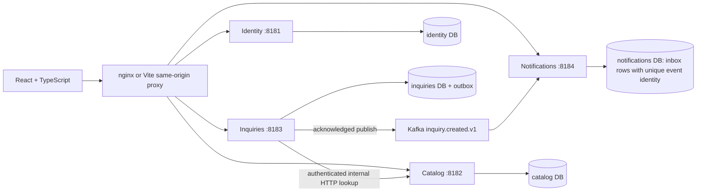

# Architecture you can explain

The browser discovers providers, clients send inquiries and providers respond. Four independent NestJS processes own those business rules. Splitting by capability gives meaningful release and data boundaries; it also increases operational overhead compared with a modular monolith. For a commercial MVP, a monolith could be the better first choice. This laboratory deliberately makes service contracts and failure behavior visible.



One source package produces a shared backend image, but `SERVICE` selects exactly one capability module and one database connection. This reduces repeated build/dependency configuration without creating a single runtime process. Every container gets its own PostgreSQL login and database. A common PostgreSQL server saves memory; its outage still affects all services. Database roles cannot connect to the other service databases. No cross-database joins or shared domain repository are permitted.

The edge hides internal provider-owner lookups from normal browser API routing. Catalog answers a bounded server-to-server lookup protected by an independent secret. Authentication establishes identity and role; business services separately check resource ownership. Shared HMAC verification keys are a laboratory compromise because a verifier can mint tokens. Public production design should use an external asymmetric issuer, rotation, and hardened browser sessions.

```mermaid
sequenceDiagram
  participant C as Client browser
  participant Q as Inquiries
  participant P as Catalog
  participant DB as Inquiries DB
  participant K as Kafka
  participant N as Notifications
  C->>Q: POST inquiry + JWT + Idempotency-Key
  Q->>P: Validate provider / internal secret
  P-->>Q: Private owner and public name
  Q->>DB: One transaction: inquiry + outbox
  DB-->>Q: Commit
  Q-->>C: Durable inquiry
  Q->>K: Publish persisted event; wait for acknowledgment
  Q->>DB: Mark outbox delivered
  K->>N: Event (may repeat)
  N->>N: Persist inbox with unique event identity
```

A crash after Kafka acknowledgment and before marking the outbox can publish twice. Notifications must handle duplicate delivery safely. This is at-least-once transport with idempotent effects, not an exactly-once transaction spanning Kafka and PostgreSQL. Retrying an HTTP inquiry uses a client-scoped idempotency key and canonical payload comparison; it must also work for simultaneous requests.

React components render, route containers compose pages, services own API calls, types define contracts, contexts expose shared authentication and hooks manage reusable state/effects. Business success is shown only after the API succeeds. Browser localStorage holds the token and comparison IDs with a project-specific namespace. The inquiry-attempt hook also temporarily saves its original key and payload in sessionStorage so an uncertain write can be reconciled safely; that saved intent is not evidence of a committed inquiry. Profiles, committed inquiries and notifications are read from APIs, which remain the source of truth. The notifications table itself has a unique event ID and serves the inbox/deduplication role; there is no separate inbox table. See the [beginner service guide](nodejs-beginner/README.md) for source-linked walkthroughs.

Local uses its own Compose namespace and loopback ports. AWS dev runs on a Terraform-managed instance with SSM access and independent state/secrets/data. It is a development environment with single-host failure risk. See [AWS dev](aws-dev.md), [data and security](interview-topics/data-security.md), and [frontend](interview-topics/frontend.md).
