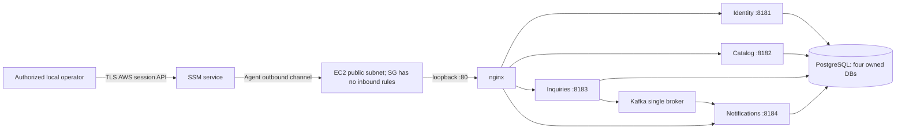
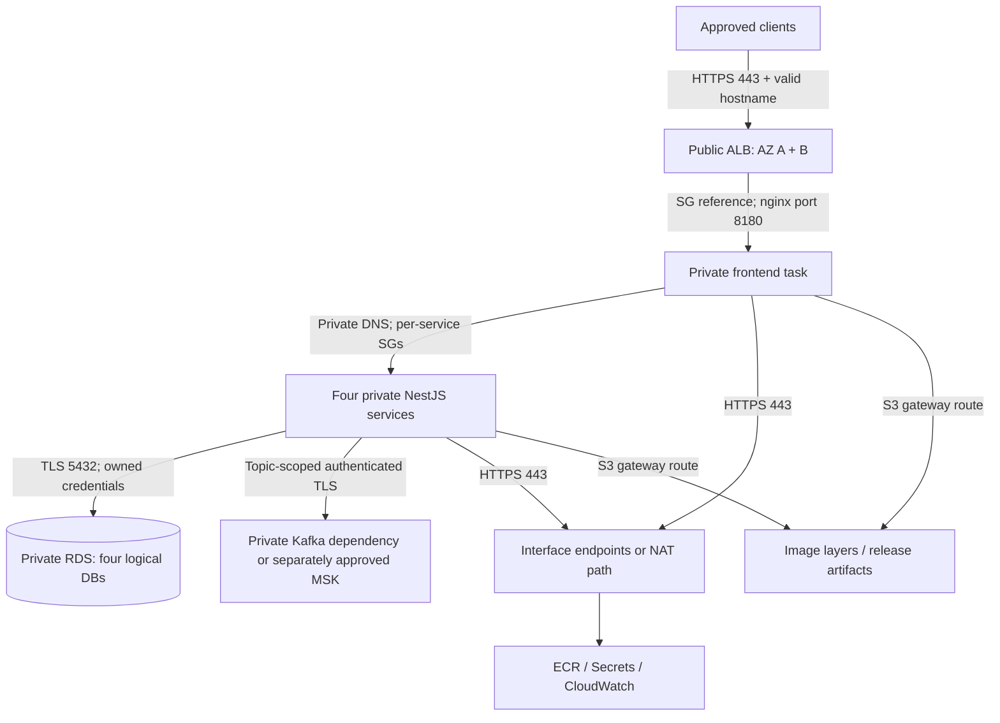

# ADR candidate: phased AWS operations laboratory

Status: proposed, 2026-10-27. No topology has been selected or implemented by this review. No AWS mutation is authorized. The 24-hour demonstration remains the operating assumption; 30-day costs are a separate comparison. Review the current price model before choosing a phase. The repository inspected was `8b2c3e0` (working tree clean). Renewed read-only checks on October 27 confirmed FREE/ACTIVE/$100 credits, no project resources found in queried scopes, and explicit MSK/OIDC SCP denials. Ohio Logs listing succeeded; create/write permissions remain unverified. See account-summary.json for scope limits. Historical October 23 plans and inventory do not prove today's state.

## What the source establishes

`infra/aws-dev/main.tf` defines one public-subnet EC2 instance, one public IPv4 address, outbound internet access, **no security-group ingress**, IMDSv2 with hop limit one, encrypted 40-GB gp3 root storage, instance IAM, two immutable ECR repositories, an encrypted/versioned private release bucket, and a Secrets Manager resource. The Compose deployment has four separate NestJS containers, one nginx frontend, PostgreSQL with four service-owned databases/logins, and a single persistent Kafka broker. nginx publishes only `127.0.0.1:80`; operators use an authenticated SSM tunnel. Docker rotates logs locally; there is no configured CloudWatch agent, centralized logs, or alarm suite. Host loss can lose both databases and Kafka because their volumes reside on the root disk, configured for deletion on termination.

Inquiries writes inquiry + outbox in one PostgreSQL transaction. A publisher sends to Kafka and marks delivered after acknowledgment. Notifications persists before Kafka offset acknowledgment and deduplicates by event identity. Preserve at-least-once transport with idempotent effects; changing a broker cannot confer exactly-once distributed transactions. Preserve the four ownership boundaries even when four logical databases share one RDS instance. One shared RDS instance remains a common failure domain.

## Proposed decision and phase boundaries

| Phase | Teaching outcome | Candidate scope | Deliberate compromise / decision gate |
|---|---|---|---|
| A | Operate and recover the existing design | Existing no-ingress EC2/SSM; bounded logs + three custom signals, alarms, database exports, restore exercise, least-privilege operator and asymmetric-token work | Lowest infrastructure complexity; one host/AZ; no high availability. No new ingress. Recommended first 24-hour exercise, conditional on account checks and cost review. |
| B | Demonstrate real TLS ingress and SG trust | Two public ALB subnets; HTTPS from approved client CIDRs; ALB SG → nginx host port only; otherwise phase A | Adds an intentional inbound path, ALB/IPv4 floors and domain/certificate prerequisites. Keeping host public with zero direct ingress avoids NAT solely for this lesson; moving it private is separately priced. |
| C | Separate stateless compute from managed data | Private ECS/Fargate services; private RDS PostgreSQL; ALB; evaluated NAT or endpoint path; separately retained private Kafka dependency | Higher floor and more migration work. Single-AZ application count/RDS saves cost but is not resilient. Do not omit Kafka from cost or quietly remove notifications. |
| D | Managed streaming learning | Temporary MSK exercise, initially isolated from main deployment; explicit auth/topic/retention/producer/consumer tests | Optional, separately approved cost and compatibility gate. Prefer recorded local Kafka failure/replay exercises before paying an idle managed-cluster floor. |

Phase B alone cannot honestly demonstrate app-SG → DB-SG separation: the baseline database remains inside the same host's Docker network. That network rule becomes meaningful in phase C when RDS has its own ENIs and SG. A separate short-lived B/RDS variant could teach it, but it must be estimated and planned explicitly. An ingress permission expands reachability; it does not automatically increase security over no ingress.

## Traffic diagrams

Current source design (not a claim of live deployment):

Phase C candidate (not implemented):

A two-AZ ALB with one backend task or one DB instance does not make the application highly available. The resilience variant needs at least two replicas per capability, suitable placement and capacity, and RDS Multi-AZ; Kafka durability/failover also has to match the claim. These are additional quantities in the cost model.

## Allowed traffic matrix

Rules below describe candidate phase C; phase A retains zero inbound host SG rules. Security groups are stateful; response traffic does not require opening a second broad ingress range. Use SG references for trust inside the VPC. Apply IPv6 restrictions too if enabling dual stack.

| Initiator | Destination | Allowed path | Explicitly disallowed |
|---|---|---|---|
| Approved client CIDRs | ALB SG | TCP 443; managed TLS policy, correct domain/certificate | Unapproved sources; direct task/host/database/Kafka access; no default 0.0.0.0/0 visitor permission |
| ALB SG | Frontend SG | TCP 8180 and same health-check port | ALB → databases/brokers; arbitrary application ports |
| Frontend SG | Each API SG | TCP 8181/8182/8183/8184 as appropriate | Public reachability; frontend → DB or Kafka |
| Inquiries SG | Catalog SG | TCP 8182 plus independent internal-call authorization | Browser-accessible internal owner lookup |
| Each API SG | RDS SG | TCP 5432; TLS verification; separate owned DB login | Any internet source; cross-service database permissions; master/admin credentials in tasks |
| Inquiries and Notifications SGs | Kafka/MSK SG | Only chosen authenticated TLS broker port; IAM uses private 9098, SCRAM private 9096 | Public broker listeners; plaintext 9092; Identity/Catalog broker access |
| Tasks SGs | Interface endpoint SG | TCP 443; service/resource endpoint policy | Open interface-endpoint ingress from internet; assuming endpoints authorize APIs without IAM |
| Tasks | S3 gateway | Prefix-list route + least-privilege policy | Public bucket/ACL; unrestricted release/state access |
| Approved operator | AWS control plane | Temporary authenticated TLS APIs; scoped SSM/ECS operations if needed | SSH 22 to compute; permanent access keys; undeclared privilege escalation |

ALB target SG references follow [AWS's recommended trust model](https://docs.aws.amazon.com/elasticloadbalancing/latest/application/load-balancer-update-security-groups.html). Kafka ports depend on authentication mode; [AWS lists the private/public port variants](https://docs.aws.amazon.com/msk/latest/developerguide/port-info.html). No public Kafka mode is proposed.

## Phase-specific implementation requirements after cost selection

**A — host, identity and recoverability.** Add resource names/tags including Project, Environment, Owner and ExpiresAt to all taggable assets; tags are inventory signals, not a billing stop. Bound CloudWatch collection to chosen application/agent files, seven-day log retention, no secrets/request bodies, and defined log-volume assumptions. Keep Docker rotation. Collect disk usage, process/container health and oldest-unpublished-outbox age; choose useful alarms, prove an alarm transition and notification delivery. Host system metrics such as filesystem use require an agent or application emission; do not claim standard EC2 CPU metrics measure disk capacity. Keep a specific host policy for permitted log writes and backup object prefix. Separate human deployment from runtime access.

Back up each owned DB with consistent `pg_dump` exports plus relevant role/grant definitions to an encrypted private destination; explicitly quiesce writes for a coordinated four-database recovery point. Independent database dumps during live writes are not a globally consistent marketplace snapshot. Record a manifest, checksums, source image/schema checksums and last verified event IDs. Before teardown, restore into isolated fresh data, verify ownership, inquiries and deduplication, and measure observed RPO/RTO. A proposed target could be RPO ≤ 24 hours and restore ≤ 60 minutes for this synthetic lab, pending rehearsal. A host snapshot alone is not evidence PostgreSQL recovery works.

SSM connection metadata and control-plane activity can support audit, but [Session Manager does not record port-forwarding session contents](https://docs.aws.amazon.com/systems-manager/latest/userguide/session-manager-logging.html). Application access records must supply HTTP-level evidence. The shared HS256 token verifier and browser localStorage token are existing lab compromises: assess asymmetric issuer/key rotation and browser-session handling as independent application work before accepting broad public ingress. Do not replace authentication providers merely to satisfy a service list.

**B — ingress.** An ALB needs [at least two AZ subnets with address headroom](https://docs.aws.amazon.com/elasticloadbalancing/latest/application/application-load-balancers.html). Obtain control of a domain and complete DNS validation for the ACM certificate in the ALB region; [an HTTPS listener needs a certificate and a TLS security policy](https://docs.aws.amazon.com/elasticloadbalancing/latest/application/create-https-listener.html). Domain registration/hosted-zone costs are separate from ALB costs; existing domain ownership is unknown. Prefer a 443-only teaching configuration; adding port 80 redirects is another permission requiring explicit review.

The current loopback publication cannot receive ALB traffic. A reviewed implementation must expose a host-private frontend port, admit only ALB SG, and retain SSM management. Decide whether ALB → target uses HTTP (VPC-only trust, documented plaintext hop) or HTTPS (target certificate lifecycle). Public TLS termination does not encrypt every backend hop. Prove correct forwarded protocol handling, secure browser origin, internal-route denial and request-size/timeouts. Source-IP allowlists can change; record the approved CIDRs and rollback method before testing.

**C — compute/data.** Keep five ECS services (frontend plus four NestJS capabilities); preserve backend image reuse with different `SERVICE`, never merge all processes merely to shrink an estimate. Each Fargate task uses awsvpc; ALB targets use IPs. The costed candidate uses ECS-managed Cloud Map service discovery with one private DNS namespace, five services and five/ten registered task resources. Clients and nginx must refresh DNS according to TTL and survive task-IP replacement; there is no assumed stable task IP or unpriced Service Connect proxy. Namespace/registry charges are included in the cost model; public DNS for the ALB remains an owner prerequisite. Initial per-service 0.25-vCPU/0.5-GB sizing is a cost input, not proven capacity. Measure memory/startup/load before selection; include rolling deployment overlap. Each API's pg pool currently permits ten connections, so calculate replicas × pools plus migration/ops headroom against DB limits. One RDS instance with four DBs reduces fixed expense while preserving logical ownership; deny cross-DB connections and table access in executable tests.

Separate an [execution role](https://docs.aws.amazon.com/AmazonECS/latest/developerguide/task_execution_IAM_role.html) (ECR pull, logs, specific injected secrets) from each task's application role. Most current API tasks need no general AWS API privileges; MSK IAM access would need narrowly scoped broker/topic/group grants on the producer/consumer roles. Do not place the DB bootstrap credential in ordinary tasks. Use separate secret resources where role isolation is required; JSON-key selection alone does not make GetSecretValue IAM authorize only one field. [Injected secrets require task replacement when rotated](https://docs.aws.amazon.com/AmazonECS/latest/developerguide/specifying-sensitive-data.html); test coordinated database/password rotation.

The existing `Database` already supports `DB_SSL=true`, `rejectUnauthorized:true` and `DB_SSL_CA`. Package the official CA bundle, use the actual RDS hostname, forbid insecure fallback and test unknown CA/wrong hostname/plaintext failures. [RDS can require TLS with rds.force_ssl](https://docs.aws.amazon.com/us_en/AmazonRDS/latest/UserGuide/PostgreSQL.Concepts.General.SSL.html). Four owned DBs/logins must be created by a separately privileged bootstrap/migration task. Prefer a once-per-release migration task with narrowly scoped DDL permissions; current startup checksum/advisory-lock migration behavior must remain safe during rollout. Demo seeding must be explicit and idempotent, with synthetic accounts only.

Private tasks need a complete egress dependency path. Fargate does not need the three ECS interface endpoints just to run. For private ECR pull on platform ≥1.4, include `ecr.api`, `ecr.dkr` and S3 gateway; logs and Secrets Manager add interface endpoints. Extra STS/ssmmessages endpoints depend on chosen SDK authentication/debugging behavior, not a mandatory blanket set. [ECS's endpoint guidance](https://docs.aws.amazon.com/AmazonECS/latest/developerguide/vpc-endpoints.html) and [ECR's dependency list](https://docs.aws.amazon.com/AmazonECR/latest/userguide/vpc-endpoints.html) establish that count. Price each endpoint × AZ. Gateway S3 has no endpoint-hour charge; interface endpoints do. The current cost comparison includes a private Kafka EC2 host. That host adds SSM and ssmmessages to the four task dependency endpoints, producing six interface endpoints per active AZ plus S3 gateway. A no-NAT host needs a reviewed prebuilt AMI/artifact route for Docker/packages and patches; current user-data internet installation cannot simply be reused.

The [new-experience region documentation](https://docs.aws.amazon.com/accounts/latest/reference/project-regions.html) places CloudWatch Logs in us-east-1. Live October 27 Ohio DescribeLogGroups succeeded; write/create grants remain unverified and must be validated in the approved deployment. An Ohio interface endpoint cannot replace cross-region access to Virginia Logs. If this restriction applies, the endpoint-only no-NAT candidate cannot ship unchanged: price NAT/transfer or a separately reviewed collection design, and do not create a same-region Logs resource that policy will reject.

No-NAT tasks cannot fetch arbitrary internet dependencies; build all dependencies into reviewed images first. One NAT shared across AZs creates an AZ dependency and possible cross-AZ transfer. Two NATs improve zonal independence at a higher fixed price.

**D — streaming.** The [current new-sign-up service list](https://docs.aws.amazon.com/accounts/latest/reference/supported-services-sign-up-new.html) lists MSK under Paid Plan, while ECS, RDS, ELB and VPC are in the Free service list. Regional service availability is not account entitlement. If the historical account remains on this Free experience, MSK is a comparison/learning option only: no upgrade or enabling MSK is authorized. Keep Kafka local initially. The Fargate/RDS deployment still needs a durable broker: price a retained private EC2 Kafka host, or separately approve MSK. A Fargate ephemeral Kafka container is not a persistence plan. MSK provisioned requires broker/storage/replication sizing, authenticated TLS and topic ACL/IAM policies. [MSK Serverless is regionally available in Ohio and requires IAM access control](https://docs.aws.amazon.com/msk/latest/developerguide/serverless.html); “serverless” does not imply a zero-idle-cost option. Current KafkaJS code has TLS but no SASL/IAM token provider; add and test auth support before integration. SCRAM's [secret naming and customer-managed KMS requirements](https://docs.aws.amazon.com/msk/latest/developerguide/msk-password-tutorial.html) add resources and cost. Precreate topics with chosen partitions, replication, retention and minimum in-sync replicas; disable auto-topic creation in managed dev. Preserve event key, group ID and deduplication contracts. Broker replacement/offset changes can replay old events; demonstrate safe reprocessing and describe when notifications cannot be reconstructed.

## Security, failure and recovery gates

These are proposed executable gates, not completed tests. Preserve all 48 API acceptance checks, authorization/failure-path tests and existing broker-outage/deduplication drills without lowering assertions.

| Gate | Required observable result / evidence |
|---|---|
| Actual scope | Renewed STS account/region, Free-plan/credits result, scoped resource inventory and any permission denials; no false empty-account conclusion from denial |
| Static plan | Saved new source-bound Terraform plan; SGs/routes/public-IP settings, replacement actions, account, region and cost quantities independently reviewed; runtime secret values absent |
| Exposure | From approved client, HTTPS works with valid hostname/TLS; disallowed client fails. No internet SSH/PG/Kafka/direct API access. Record SG checks and bounded tests only against owned endpoints. |
| Identity | Missing/tampered/wrong-role/wrong-owner tokens rejected; internal owner endpoint inaccessible from browser path; runtime role cannot list/read unrelated secrets or write releases |
| Database | TLS positive and wrong-CA/hostname/plaintext negative tests; each login denied all other DBs; pool saturation and retry behavior preserve correct errors |
| Release | Exact-source CI Sonar gate and immutable image digest evidence; full 48-pass cloud report identifies source SHA, target and command; health-only success is insufficient |
| Broker loss | Pause/disconnect broker in an approved test; inquiry remains durable with retried same key; backlog is visible; recovery delivers exactly one inbox effect despite repeated events |
| Health model | Distinguish web serving, DB readiness and async degradation. Current worker-dependent readiness would evict inquiries during Kafka failure if wired directly into ALB; design/test a policy that preserves durable acceptance where intended. nginx /health alone proves only the edge. |
| Migration | Two replicas do not run conflicting migrations; bad checksum prevents rollout; expand/contract schema works with previous image; destructive migration has explicit data-recovery boundary |
| Recovery | Restore backup into a new isolated DB/host, not production volume; verify row counts, ownership, outbox/inbox identities and 48 checks; report observed RPO/RTO and recovery cost |
| Rollback | Inject bad image/readiness; previous completed release restored and verified. [ECS circuit-breaker rollback requires a completed deployment](https://docs.aws.amazon.com/AmazonECS/latest/developerguide/deployment-circuit-breaker.html); first deployment cannot promise prior-release rollback. |
| Operations | One real alarm transition plus delivery proof; log retention and redaction shown; no claiming tunnel contents are audited; deployment failure evidence preserved |
| Cleanup | Resource inventory after destroy shows no remaining unintended billable resources; retained list, deletion dates and residual daily cost recorded; recheck delayed billing separately |

## Recovery and rollback boundaries

Image rollback restores code only when schema/data remain compatible. It cannot undo destroyed columns, rotate a database password back automatically, recover deleted Kafka topics, or reconstruct all business state from logs. An RDS [snapshot restore creates a new DB instance](https://docs.aws.amazon.com/AmazonRDS/latest/UserGuide/USER_RestoreFromSnapshot.html); redirect configuration only after isolated validation, with a write-freeze and an explicit data-loss/catch-up decision. Restoring an old snapshot can lose successful writes after its recovery point. Multi-AZ failover is availability protection, not protection from logical deletion.

Do not recycle the old single-host saved plan for a changed phase. After a cost-approved topology is implemented, generate fresh mock/static checks and an authenticated saved plan, current model and source/plan hashes for review. Bootstrap is a separate billable-account mutation requiring review; a local-backend preview is not the final S3-backed apply artifact. Record distinct approvals for bootstrap, final infrastructure, release and any destructive recovery operation where appropriate. No account-plan upgrade or policy bypass is proposed.

## 24-hour closure and residuals

Before provisioning, agree the start timestamp, exact teardown deadline and operator; no timer is currently scheduled. A budget alert is delayed notification, not a hard cap. At the deadline stop new traffic/writes, save only required sanitized evidence, complete the selected restore exercise, then review and apply a saved destroy plan. Delete ALB/listeners, ECS services/tasks, NATs/EIPs, interface endpoints, broker compute/MSK and RDS according to the reviewed retention decision. Stopping compute does not remove ALB, NAT, endpoints, volumes, logs, secrets, snapshots or stored images. [Stopped RDS retains storage/backup charges and auto-starts after seven days](https://docs.aws.amazon.com/AmazonRDS/latest/UserGuide/USER_StopInstance.html).

Record each deliberately retained item: state bucket/object versions/locks, release bucket versions and delete markers, ECR tagged images, DB final snapshots/retained automated backups, EBS snapshots/volumes, CloudWatch logs, Route53 zone/domain and customer KMS keys. Set explicit owner/expiry and residual price per item. Preserve KMS decryptability until retained encrypted backups are discarded; deleting a key first can make retention useless. MSK is not a stopped-cluster cost-saving strategy: delete the learning cluster when finished. Final snapshots/exports add storage cost and restoration compute; the cost model must include the measured restore rehearsal separately from the steady runtime.

The bootstrap state bucket intentionally has prevent_destroy; export and encrypt necessary state, then separately review protection removal and version-aware cleanup. Do not automatically destroy unrelated account resources or the local environment. Confirm cleanup by control-plane inventory first, then check delayed costs and credits; missing permissions limit the verification claim.

## Decisions still needed

Choose phase and maximum planned gross cost after reviewing the cost comparison; account credits do not eliminate resource charges. Confirm domain ownership and approved ingress client CIDRs if phase B/C is chosen. Choose one-AZ lab versus tested resilience variant, NAT versus complete private endpoints, managed-broker timing, backup retention/RPO/RTO and exact teardown ownership. Current recommendation is phase A first, then one separately budgeted B or C exercise; phase D remains optional. The learning chat should reference proposed diagrams as proposals until real code and test evidence exist.
