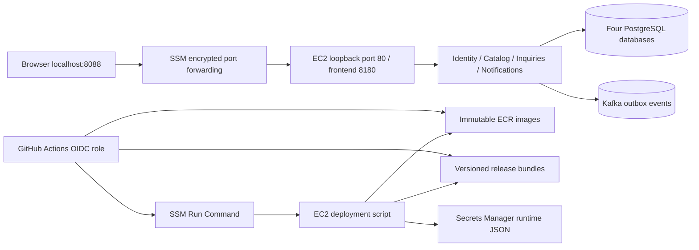

# AWS dev: deployment and operating guide

This environment is an isolated interview/development target. Local Compose needs no AWS account and never selects AWS credentials. AWS preparation is source code, not proof of a deployment: no account-specific plan, apply, image publication, GitHub run, or AWS business journey is claimed until separately evidenced. Read [cost assumptions](costs.md), [toolchain gates](toolchain.md), and [Azure discussion](azure-mapping.md).

## Why one EC2 host

The four Node services, PostgreSQL, Kafka, and frontend run on one `t3.medium` Amazon Linux 2023 host. Each service still owns a distinct database and role. A single host keeps a small dev environment explainable and avoids an ALB, NAT gateway, RDS, and managed Kafka baseline bill. ECS/Fargate plus RDS/MSK would improve service lifecycle and database resilience, but brings more infrastructure and a higher minimum bill. This deployment has no high availability, automated backups, or production SLO claim. Database and Kafka volumes live on the encrypted root disk: replacing/terminating the instance loses them. Snapshot/export before replacement.



The VPC has a public subnet for outbound internet access. There are **zero security-group ingress rules**. Public IPv4 enables outbound package/image/API access; it does not make the app reachable. SSM authenticates operators and tunnels browser traffic. No SSH key, public HTTP listener, load balancer, or NAT gateway is provisioned. Database/broker ports are confined to Docker networking. Runtime secrets are fetched by the instance role into a mode 0600 `.env`; Terraform creates only the empty secret container, so values do not enter Terraform state. Root/SSM operators can read host secrets; that is an explicit dev trust boundary. AWS dev explicitly sets `SEED_DEMO=true` to load the same synthetic interview accounts used by acceptance tests. Their documented demo passwords are suitable only for this private dev environment; disable seeds and replace authentication before any public or production use.

## Prerequisites and review boundary

Install AWS CLI v2, Terraform >=1.10, and the AWS Session Manager plugin. Sign in using an AWS SSO profile with rights to plan the listed infrastructure. Use the independent GitHub repository, not the reference repository. Terraform state and AWS credentials must never enter Git. Confirm account, region, cost allocation, IAM permissions, billing alerts, and retention requirements with the reviewer.

```bash
export AWS_PROFILE=marketplace-dev
export AWS_REGION=us-east-1
aws sts get-caller-identity
```

The commands below prepare plans. **Do not apply either bootstrap or dev plans until the concrete saved plan and costs are reviewed and approved.** IAM/provider creation, even bootstrap, is an external account change.

```bash
terraform -chdir=infra/bootstrap init
terraform -chdir=infra/bootstrap plan \
  -var='state_bucket=YOUR-ACCOUNT-linked-in-terraform-state' \
  -var='create_github_oidc=false' -out=bootstrap.tfplan
terraform -chdir=infra/bootstrap show -no-color bootstrap.tfplan
```

Set `create_github_oidc=true` only if the account has no existing `https://token.actions.githubusercontent.com` provider. The bootstrap state is initially local: secure and back it up separately. The state bucket has encryption, versioning, no public access, TLS enforcement, and `prevent_destroy`. The app backend uses S3 native lock files; the operator needs Get/Put/List rights on the exact state key plus Get/Put/Delete on its `.tflock` object. See [HashiCorp S3 backend documentation](https://developer.hashicorp.com/terraform/language/backend/s3).

After approved bootstrap application, use its actual bucket and existing/created OIDC ARN:

```bash
cp infra/aws-dev/backend.hcl.example infra/aws-dev/backend.hcl
cp infra/aws-dev/dev.tfvars.example infra/aws-dev/dev.tfvars
# Edit both files with the actual account/bucket/repository values.
terraform -chdir=infra/aws-dev init -backend-config=backend.hcl
terraform -chdir=infra/aws-dev plan -var-file=dev.tfvars -out=dev.tfplan
terraform -chdir=infra/aws-dev show -no-color dev.tfplan > work/aws-dev-plan.txt
```

Review resource counts, actual AMI/region, replacement/destruction actions, IAM principals, image repositories, secret ARN, persistent data loss, and the dated cost model. Record the plan file SHA256, source commit, account ID, approval, and expiry. Only then may an operator run `terraform -chdir=infra/aws-dev apply dev.tfplan`. Re-plan if inputs/source/account change. CI has no Terraform apply permission or automatic infrastructure apply job.

## Populate fresh AWS-only secrets

Once the approved infrastructure exists, generate separate random values. Do not reuse local `.env` or reference-project secrets. This command writes a private temporary file without printing secret values:

```bash
umask 077
python3 - <<'PY'
import json,secrets
from pathlib import Path
keys=['POSTGRES_PASSWORD','IDENTITY_DB_PASSWORD','CATALOG_DB_PASSWORD','INQUIRIES_DB_PASSWORD','NOTIFICATIONS_DB_PASSWORD','JWT_SECRET','INTERNAL_API_KEY']
Path('work/aws-dev-secrets.json').write_text(json.dumps({k:secrets.token_hex(32) for k in keys}))
PY
export AWS_SECRET_ARN=$(terraform -chdir=infra/aws-dev output -raw secret_arn)
aws secretsmanager put-secret-value --secret-id "$AWS_SECRET_ARN" \
  --secret-string file://work/aws-dev-secrets.json
rm work/aws-dev-secrets.json
```

The deploy script rejects values outside lowercase hex of at least 64 characters, which also avoids URL/Compose escaping ambiguity. Database initialization uses these values only when the volume is empty. Password rotation requires coordinated PostgreSQL `ALTER ROLE`, Secrets Manager update, and app restart; changing secret JSON alone does not change existing roles. Shared HS256 is a demo compromise: every verifier could mint tokens. A production issuer should use asymmetric verification keys and rotation.

## GitHub setup and release

Create a protected `dev` environment with required reviewer(s), deployment branch restricted to `main`, and no self approval if your plan supports it. Protect `main` with required source/integration/Terraform checks and review. OIDC trust admits only `repo:OWNER/REPO:environment:dev`; AWS credentials are temporary, not repository secrets. See [GitHub OIDC guidance](https://docs.github.com/en/actions/how-tos/secure-your-work/security-harden-deployments/oidc-in-aws).

Set these **dev environment variables** from Terraform outputs: `AWS_REGION`, `AWS_INSTANCE_ID`, `AWS_RELEASE_BUCKET`, `AWS_SECRET_ARN`, `AWS_DEPLOY_ROLE_ARN`, `BACKEND_REPOSITORY`, and `FRONTEND_REPOSITORY`. Configure repository `SONAR_HOST_URL` and secret `SONAR_TOKEN` as described in [toolchain](toolchain.md). No Sonar pass is implied by adding a token.

Manually dispatch **Deploy AWS dev** from `main`. It rechecks source, coverage, dependencies, and full local acceptance; waits for the actual SonarQube gate; requests environment approval; obtains OIDC credentials; builds linux/amd64 images tagged with source SHA; resolves immutable digests; scans the published images for High/Critical findings; bundles the exact source SHA/digests; and deploys via SSM. The host pulls, checks all readiness endpoints, and runs the full acceptance suite through nginx. A failed rollout restores previous images. First deployment has no previous release to restore and remains a failed deployment; inspect logs before retrying.

Save the workflow run URL, Git SHA, manifest, image digests, scan results, SSM command ID/output, and business acceptance report to the requirement/release record. ECR tags are immutable; a rerun reuses the existing source-SHA images, rescans their digests, and deploys them again. Change source to produce new images; never change immutability or delete evidence merely to get a green rerun.

## Access, logs, migration, rollback

```bash
export AWS_INSTANCE_ID=$(terraform -chdir=infra/aws-dev output -raw instance_id)
aws ssm start-session --target "$AWS_INSTANCE_ID" \
  --document-name AWS-StartPortForwardingSession \
  --parameters '{"portNumber":["80"],"localPortNumber":["8088"]}'
# In another terminal/browser: http://localhost:8088
node scripts/acceptance.mjs http://localhost:8088 work/aws-dev-acceptance.json
```

[Session Manager port forwarding](https://docs.aws.amazon.com/systems-manager/latest/userguide/session-manager-working-with-sessions-start.html) needs the local Session Manager plugin and operator `ssm:StartSession` plus session permissions. The deploy role has Run Command access only to this instance; the instance has only the one runtime secret, release-prefix read, ECR pull, and managed SSM agent permissions. `ecr:GetAuthorizationToken` and `ssm:GetCommandInvocation` require wildcard resource scopes; image/S3/secret access is narrowed separately.

For diagnosis, open an authorized SSM shell (`aws ssm start-session --target "$AWS_INSTANCE_ID"`), then:

```bash
sudo -i
cloud-init status --wait
cd /opt/marketplace/current
marketplace-compose -f compose.yaml ps
marketplace-compose -f compose.yaml logs --tail=200 inquiries notifications
bash ./aws-smoke.sh
```

Docker logs rotate at 3 × 10 MB per container. No CloudWatch agent, distributed tracing stack, or automated alerting is falsely claimed. Configure centralized logs and alarms before extending this beyond dev. Startup migrations are per-service and recorded in each database. Use expand/contract changes compatible with both old and new app versions. Image rollback cannot reverse destructive database migrations; restore a verified backup or roll forward instead.

The deployment retains `/opt/marketplace/releases/SHA` and updates the `current` symlink only after successful verification. To restore a known release manually, enter that release directory in an SSM shell, run `marketplace-compose -f compose.yaml up -d --wait`, verify `bash ./aws-smoke.sh`, run its bundled acceptance script using the backend Node image, and repoint `current`. Never run `down -v` during rollback.

## Cleanup

Before cleanup, export/snapshot needed databases and save evidence. Stop the instance for an overnight pause; disk/secret/ECR/S3 charges continue while stopped. Before permanent deletion, create and review `terraform plan -destroy -var-file=dev.tfvars -out=destroy.tfplan` from `infra/aws-dev`. Approve exact resources and data deletion. Empty the environment's ECR repositories and versioned release bucket only when their retained evidence is no longer needed, then apply the approved destroy plan. Secrets Manager keeps the configured seven-day recovery window. The bootstrap state bucket intentionally survives; do not remove its protection until retained states and lock ownership have been audited. Confirm billing and tagged resources afterward. No cleanup job has been scheduled.
