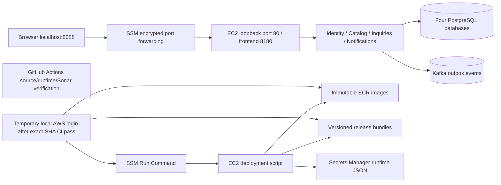

# AWS dev: deployment and operating guide

This environment is an isolated interview/development target. Local Compose needs no AWS account and never selects AWS credentials. AWS preparation is source code, not proof of a deployment: account-specific preparation is recorded separately from apply, image publication, and AWS business journeys. No deployment is claimed from a plan or a workflow definition. Read [cost assumptions](costs.md), [toolchain gates](toolchain.md), and [Azure discussion](azure-mapping.md).

## Why one EC2 host

The four Node services, PostgreSQL, Kafka, and frontend run on one `m7i-flex.large` Amazon Linux 2023 x86_64 host (2 vCPU, 8 GiB RAM) in `us-east-2` for the selected 24-hour Free plan demonstration. Each service still owns a distinct database and role. A single host keeps a small dev environment explainable and avoids an ALB, NAT gateway, RDS, and managed Kafka baseline bill. ECS/Fargate plus RDS/MSK would improve service lifecycle and database resilience, but brings more infrastructure and a higher minimum bill. This deployment has no high availability, automated backups, or production SLO claim. Database and Kafka volumes live on the encrypted root disk: replacing/terminating the instance loses them. Snapshot/export before replacement.



The VPC has a public subnet for outbound internet access. There are **zero security-group ingress rules**. Public IPv4 enables outbound package/image/API access; it does not make the app reachable. SSM authenticates operators and tunnels browser traffic. No SSH key, public HTTP listener, load balancer, or NAT gateway is provisioned. Database/broker ports are confined to Docker networking. Runtime secrets are fetched by the instance role into a mode 0600 `.env`; Terraform creates only the empty secret container, so values do not enter Terraform state. Root/SSM operators can read host secrets; that is an explicit dev trust boundary. AWS dev explicitly sets `SEED_DEMO=true` to load the same synthetic interview accounts used by acceptance tests. Their documented demo passwords are suitable only for this private dev environment; disable seeds and replace authentication before any public or production use.

## Prerequisites and review boundary

Install AWS CLI v2, Terraform >=1.10, and the AWS Session Manager plugin. Sign in using a temporary AWS CLI profile with rights to plan the listed infrastructure. `aws login` is the selected path; do not create long-lived access keys for this demo. Use the independent GitHub repository, not the reference repository. Terraform state and AWS credentials must never enter Git. Confirm account, region, cost allocation, IAM permissions, billing alerts, and retention requirements with the reviewer.

```bash
export AWS_PROFILE=marketplace-dev
export AWS_REGION=us-east-2
aws sts get-caller-identity
```

The commands below prepare plans. **Do not apply either bootstrap or dev plans until the concrete saved plan and costs are reviewed and approved.** IAM/provider creation, even bootstrap, is an external account change.

```bash
terraform -chdir=infra/bootstrap init
terraform -chdir=infra/bootstrap plan \
  -var='region=us-east-2' \
  -var='state_bucket=YOUR-ACCOUNT-linked-in-terraform-state' \
  -var='create_github_oidc=false' -out=bootstrap.tfplan
terraform -chdir=infra/bootstrap show -no-color bootstrap.tfplan
```

The selected Free plan path keeps `create_github_oidc=false`. The account denied IAM OIDC-provider operations through an AWS-managed service control policy. Do not retry provider creation, loosen trust, or upgrade the account to bypass that policy. An optional GitHub OIDC mode remains available for a separately authorized eligible account; only that mode may need `create_github_oidc=true` after checking for an existing provider. The bootstrap state is initially local: secure and back it up separately. The state bucket has encryption, versioning, no public access, TLS enforcement, and `prevent_destroy`. The app backend uses S3 native lock files; the operator needs Get/Put/List rights on the exact state key plus Get/Put/Delete on its `.tflock` object. See [HashiCorp S3 backend documentation](https://developer.hashicorp.com/terraform/language/backend/s3).

Before bootstrap, `terraform init -backend=false` supports validation and mock tests only. A dev preview in an isolated scratch copy with a local backend can show account-specific resources without creating the state bucket; that preview is **not** the final deployable S3-backed plan. After approved bootstrap application, use the actual state bucket and generate a fresh final dev plan:

```bash
cp infra/aws-dev/backend.hcl.example infra/aws-dev/backend.hcl
cp infra/aws-dev/dev-local.tfvars.example infra/aws-dev/dev.tfvars
# Edit the backend bucket and set its region to us-east-2.
# Keep enable_github_deployment=false in the selected local-login mode.
terraform -chdir=infra/aws-dev init -backend-config=backend.hcl
terraform -chdir=infra/aws-dev plan -var-file=dev.tfvars -out=dev.tfplan
terraform -chdir=infra/aws-dev show -no-color dev.tfplan > work/aws-dev-plan.txt
```

Review resource counts, actual AMI/region, replacement/destruction actions, IAM principals, image repositories, secret ARN, persistent data loss, and the dated cost model. Record the plan file SHA256, source commit, account ID, approval, and expiry. Only then may an operator run `terraform -chdir=infra/aws-dev apply dev.tfplan`. Re-plan if inputs/source/account change. CI has no Terraform apply permission or automatic infrastructure apply job.

## Populate fresh AWS-only secrets

Once the approved infrastructure exists, generate separate random values. Do not reuse local `.env` or reference-project secrets. This command writes a private temporary file without printing secret values:

```bash
umask 077
python3 - <<'PY'
import json,secrets
from pathlib import Path
keys=['POSTGRES_PASSWORD','IDENTITY_DB_PASSWORD','CATALOG_DB_PASSWORD','INQUIRIES_DB_PASSWORD','NOTIFICATIONS_DB_PASSWORD','JWT_SECRET','INTERNAL_API_KEY']
Path('work/aws-dev-secrets.json').write_text(json.dumps({k:secrets.token_hex(32) for k in keys}))
PY
export AWS_SECRET_ARN=$(terraform -chdir=infra/aws-dev output -raw secret_arn)
aws secretsmanager put-secret-value --secret-id "$AWS_SECRET_ARN" \
  --secret-string file://work/aws-dev-secrets.json
rm work/aws-dev-secrets.json
```

The deploy script rejects values outside lowercase hex of at least 64 characters, which also avoids URL/Compose escaping ambiguity. Database initialization uses these values only when the volume is empty. Password rotation requires coordinated PostgreSQL `ALTER ROLE`, Secrets Manager update, and app restart; changing secret JSON alone does not change existing roles. Shared HS256 is a demo compromise: every verifier could mint tokens. A production issuer should use asymmetric verification keys and rotation.

## Selected Free plan release: GitHub verifies, local login deploys

The selected mode uses `infra/aws-dev/dev-local.tfvars.example`: `us-east-2`, `m7i-flex.large`, and `enable_github_deployment=false`. Terraform omits the GitHub deploy IAM role/policy and returns a null `deploy_role_arn`. The EC2 instance role, narrowly scoped secret/image/release permissions, instance profile, and managed SSM permissions remain. No OIDC provider is created or used. Account policies may still block an individual operation: preserve the failure and resolve it without inferring permissions from successful login.

Manually dispatch **Deploy AWS dev** on the reviewed `main` commit with `deploy=false`. Its verification job checks source, Jest/Vitest coverage, builds, dependency audit, deployment fixtures, and all 48 local HTTP checks. It then starts an isolated temporary SonarQube server and scans the actual source. The release gate copies Sonar Way's new-code conditions unchanged and adds equivalent overall conditions: coverage at least 80%, zero violations, duplication at most 3%, and 100% reviewed security hotspots when applicable. The fresh server has no new-code baseline, so the required overall coverage condition prevents a first analysis from passing without evaluating source coverage. The temporary server is removed after verification. This is distinct from the hosted SonarQube Cloud workflow, which remains configured and pending the owner's organization/project/token. The laptop's local SonarQube is also independent.

After an approved infrastructure apply and AWS-only secret initialization, use the local release helper from a clean checkout and your temporary `marketplace-dev` AWS profile. It requires a successful verification-only run for the exact source SHA, checks the AWS account against Terraform outputs, builds linux/amd64 images, publishes source-SHA tags, resolves immutable digests, and uses Trivy to reject High/Critical findings including unfixed ones before invoking `scripts/aws-deploy.sh`. See the helper's required environment variables and commands below; it must fail rather than deploy an unverified or dirty source tree. No access key or local login token is uploaded to GitHub.

```bash
export AWS_PROFILE=marketplace-dev
export AWS_REGION=us-east-2
export PATH="$PWD/work/tools/trivy-0.76.1:$PATH"
aws sts get-caller-identity
# After the approved dev infrastructure exists, export the Terraform outputs:
export AWS_INSTANCE_ID=$(terraform -chdir=infra/aws-dev output -raw instance_id)
export AWS_RELEASE_BUCKET=$(terraform -chdir=infra/aws-dev output -raw release_bucket)
export AWS_SECRET_ARN=$(terraform -chdir=infra/aws-dev output -raw secret_arn)
export BACKEND_REPOSITORY=$(terraform -chdir=infra/aws-dev output -raw backend_repository)
export FRONTEND_REPOSITORY=$(terraform -chdir=infra/aws-dev output -raw frontend_repository)
# Run the source/CI/account-checked local release helper (requires Docker, gh, Trivy):
bash scripts/aws-release-local.sh SUCCESSFUL_VERIFICATION_RUN_ID
```

The host pulls the exact images, checks every readiness endpoint, and runs the full acceptance suite through nginx. Success requires the exact SSM command response to contain all 48 PASS results and zero failures; its command ID, instance ID, and source SHA are saved with the report. A failed rollout restores previous images when a prior release exists. First deployment has no previous release to restore and remains a failed deployment; inspect logs before retrying.

Save the verification run URL, source SHA, manifest, image digests, scan results, SSM command ID/output, and AWS acceptance report to the requirement/release record. ECR tags are immutable. Reuse and rescan an existing exact-SHA image on a retry; source changes require new tags. Never reduce quality/security gates to obtain a pass.

## Optional GitHub OIDC deployment mode

This mode is retained for an account permitting GitHub OIDC and a GitHub plan supporting the required private-repository environment. It is **not selected for this Free plan demonstration**. Use `dev.tfvars.example`, set `enable_github_deployment=true`, and supply an existing provider ARN. Validation rejects a missing provider. Trust admits only the exact repository `dev` environment and STS audience.

Create a protected `dev` environment restricted to `main` with appropriate required reviewers. Set its `AWS_REGION`, `AWS_INSTANCE_ID`, `AWS_RELEASE_BUCKET`, `AWS_SECRET_ARN`, `AWS_DEPLOY_ROLE_ARN`, `BACKEND_REPOSITORY`, and `FRONTEND_REPOSITORY` variables from Terraform outputs. Dispatch **Deploy AWS dev** with `deploy=true`. It runs the same verification first, then requests environment approval, obtains temporary OIDC credentials, publishes/scans digest images, and deploys through SSM. No Terraform apply path exists in CI. See [GitHub OIDC guidance](https://docs.github.com/en/actions/how-tos/secure-your-work/security-harden-deployments/oidc-in-aws).

## Access, logs, migration, rollback

```bash
export AWS_INSTANCE_ID=$(terraform -chdir=infra/aws-dev output -raw instance_id)
aws ssm start-session --target "$AWS_INSTANCE_ID" \
  --document-name AWS-StartPortForwardingSession \
  --parameters '{"portNumber":["80"],"localPortNumber":["8088"]}'
# In another terminal/browser: http://localhost:8088
node scripts/acceptance.mjs http://localhost:8088 work/aws-dev-acceptance.json
```

[Session Manager port forwarding](https://docs.aws.amazon.com/systems-manager/latest/userguide/session-manager-working-with-sessions-start.html) needs the local Session Manager plugin and operator `ssm:StartSession` plus session permissions. In optional GitHub mode, the deploy role has Run Command access only to this instance; the instance has only the one runtime secret, release-prefix read, ECR pull, and managed SSM agent permissions. `ecr:GetAuthorizationToken` and `ssm:GetCommandInvocation` require wildcard resource scopes; image/S3/secret access is narrowed separately.

For diagnosis, open an authorized SSM shell (`aws ssm start-session --target "$AWS_INSTANCE_ID"`), then:

```bash
sudo -i
cloud-init status --wait
cd /opt/marketplace/current
marketplace-compose -f compose.yaml ps
marketplace-compose -f compose.yaml logs --tail=200 inquiries notifications
bash ./aws-smoke.sh
```

Docker logs rotate at 3 × 10 MB per container. No CloudWatch agent, distributed tracing stack, or automated alerting is falsely claimed. Configure centralized logs and alarms before extending this beyond dev. Startup migrations are per-service and recorded in each database. Use expand/contract changes compatible with both old and new app versions. Image rollback cannot reverse destructive database migrations; restore a verified backup or roll forward instead.

The deployment retains `/opt/marketplace/releases/SHA` and updates the `current` symlink only after successful verification. To restore a known release manually, enter that release directory in an SSM shell, run `marketplace-compose -f compose.yaml up -d --wait`, verify `bash ./aws-smoke.sh`, run its bundled acceptance script using the backend Node image, and repoint `current`. Never run `down -v` during rollback.

## Cleanup

Use the [24-hour runbook](short-run.md) for the temporary interview deployment. Before cleanup, export/snapshot needed databases and save evidence. Stopping the instance alone leaves storage charges. Before deletion, create and review `terraform plan -destroy -var-file=dev.tfvars -out=destroy.tfplan` from `infra/aws-dev` and apply that same saved plan. The dev ECR repositories and versioned release bucket are configured for force deletion during destroy; this discards their images and objects. Secrets Manager keeps the configured seven-day recovery window but does not charge secrets marked for deletion. The bootstrap state bucket intentionally survives the dev destroy; follow the separate state-export and version-aware bucket cleanup in the runbook to remove the final AWS footprint. Confirm billing and tagged resources afterward. No cleanup job has been scheduled.
