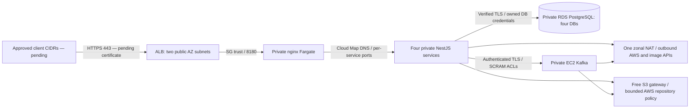

# Private ECS/RDS development environment

**Selected for preparation on 27 October 2026; not provisioned.** This implements the private ECS/RDS + one NAT option from the [cost-first review](aws-cost-review-2026-10-27/README.md). The existing `infra/aws-dev` EC2/SSM root is preserved. Local Compose keeps its original ports, credentials and volumes.

The owner has no hostname yet. The first saved plan therefore has **no ALB listener, no client CIDR ingress, no application task definitions/services, and no invented domain or certificate ARN**. It creates paid infrastructure if applied, but it cannot serve the marketplace. Do not apply this staging preview merely to wait for a domain. No HTTP fallback, domain purchase, account upgrade or AWS mutation was performed.

## Architecture and cost



The private application subnet, RDS primary and Kafka host are in one AZ. RDS also needs a second subnet for its subnet group; that does not make this Single-AZ database resilient. Five separate Fargate services run at 0.25 vCPU/0.5 GiB each after activation. Each capability retains its own DB and login. Kafka is an explicit persistent dependency, not an ephemeral Fargate container or unpriced MSK service.

| Scope / expected usage | 24 hours | 720 hours |
|---|---:|---:|
| Actual hostname-free infrastructure staging | $6.70 | $187.07 |
| Future five-task application activation, not in this plan | $8.31 | $235.52 |

Gross list-price estimates before credits, not limits. [Exact itemized idle/expected/higher scenarios](evidence/ecs-preparation/staging-plan-cost-review.json) use the dated Ohio rates from the previous review. The concrete implementation has **seven secrets, three host custom metrics and seven standard alarm metrics**. The earlier $8.37 model used five secrets, eight metrics, ten alarms and a cross-AZ allowance. Actual backend/database/broker traffic is same-AZ; ALB-to-target transfer is not charged as ordinary cross-AZ. API/image NAT traffic, logs, storage, backups, queries, ECR/S3 requests, IPs and egress remain explicit consumption inputs. Secret cost is conservatively counted even before every runtime value is populated.

Add approximately $0.048 per extra hour for a small RDS clone plus validation task, its actual backup/log/network use, and any additional restore time. A nonexportable ACM public certificate integrated with ALB has no additional certificate fee. Domain registration is not included or purchased. A new private Cloud Map zone incurs nonprorated Route53 zone charges; the 30-day example conservatively crosses two calendar months. No MSK, WAF, customer KMS key, interface endpoints, public database, SSH or public Kafka is enabled.

## Separation, credentials and network rules

`infra/aws-ecs-dev` has its own `ecs-dev` resource namespace and remote state key `linked-in-node/ecs-dev/terraform.tfstate`. Do not use the baseline's `linked-in-node/dev/terraform.tfstate`. The first private saved artifact uses a scratch local backend because the remote bootstrap bucket has not been provisioned; it is a preview, never the final S3-backed apply file.

ALB client ingress defaults empty. Supplying a hostname, issued Ohio certificate and approved /24-or-narrower client CIDRs configures only HTTPS 443. ALB SG → frontend 8180; frontend SG → four API ports; Inquiries SG → Catalog 8182; API/bootstrap SGs → RDS 5432; Inquiries/Notifications SGs → Kafka 9093. There is no internet SSH, PostgreSQL, broker or direct API listener. API hops behind the ALB use private HTTP under these SG boundaries; this is not an end-to-end TLS claim. Database and broker client paths verify TLS.

The S3 gateway policy includes the ECR starport layer bucket and the official AL2023 repository bucket. Gateway routing takes precedence over NAT, so a policy that omitted the OS repository would prevent host bootstrap. The operations bucket is not a general application upload destination. Host installation can use outbound 80/443; tasks get only needed private service paths plus outbound 443. [AWS-owned repository resources](https://github.com/aws-samples/data-perimeter-policy-examples/blob/main/service_owned_resources.md)

Six runtime secret resources: four owned database credentials, shared signing/internal-call keys and public Kafka CA, and a broker-only TLS/private-key/SCRAM configuration. RDS creates the seventh managed administrator secret. Runtime secret values are absent from Terraform and user-data. Each execution role reads only its owned/shared resources; ordinary tasks receive no AWS API policy. Bootstrap alone can inject master plus owned DB passwords. The broker role cannot fetch application passwords.

ECS uses `DB_HOST`, `DB_PORT`, `DB_NAME`, `DB_USER`, `DB_PASSWORD`, `DB_SSL=true`, `DB_SSL_CA_FILE` and `DEPLOYMENT_MODE=aws-ecs`. The old local `DB_URL` still works. TLS-downgrading URL options are rejected. The image contains the official Ohio RDS CA bundle with documented checksum. `rds.force_ssl=1`; password-bearing failed bootstrap SQL is not exported as full statements (`log_statement=none`, `log_min_error_statement=panic`). The local drill checks both CLI and server logs for generated passwords. [PostgreSQL statement logging](https://www.postgresql.org/docs/17/runtime-config-logging.html)

Broker clients use separate SCRAM-SHA-512 identities over verified TLS. Inquiries can produce to the inquiry topic; Notifications can read using its consumer group and cannot publish. Topics/ACLs are created explicitly. The host has IMDSv2, encrypted 40-GiB gp3, and no public IP. A boot-ordered firewall rule denies Kafka UID 1000 access to IMDS even with host networking; hop limit alone would not isolate that container. This still needs the live EC2 negative test. Bootstrap retries safely while the initially empty broker secret awaits its approved value. Kafka retains persistent storage, bounded retention and a pinned upstream image.

## What was verified locally

Commands run against this source, with no AWS mutations:

```bash
npm run check
npm test
npm run build
node --test scripts/aws-deploy.test.mjs scripts/aws-release-local.test.mjs scripts/aws-ecs-publish-local.test.mjs
terraform -chdir=infra/aws-ecs-dev init -backend=false -input=false
terraform -chdir=infra/aws-ecs-dev validate
terraform -chdir=infra/aws-ecs-dev test
terraform -chdir=infra/aws-ecs-certificate init -input=false
terraform -chdir=infra/aws-ecs-certificate test
python3 scripts/aws-ecs-runtime-integration.py --report work/ecs-db.json
python3 scripts/aws-ecs-kafka-integration.py --report work/ecs-kafka.json
python3 scripts/aws-ecs-frontend-dns-test.py --frontend-image linked-in-node/frontend:local
node scripts/acceptance.mjs http://localhost:8180 work/ecs-acceptance.json
node scripts/browser-smoke.mjs http://localhost:8180
node scripts/failure-drill.mjs
```

[Evidence](evidence/ecs-preparation/verification-manifest.json) distinguishes fresh execution from pending cloud gates. Terraform tests mock every provider; `command=apply` in a test applies local mocks, never real AWS resources. Real disposable PostgreSQL tests cover TLS, wrong CA/hostname/plaintext denial, twelve cross-database denials, migration idempotence, replay/deduplication and password redaction. Kafka tests exercise actual TLS/SCRAM/ACL behavior from the user-data configuration. DNS tests occupy the old task address before replacement and verify nginx follows the new DNS answer without losing `$host`. A first fixture failed because static Docker IPs need an explicit subnet; that fixture was repaired, without weakening the IP-change assertion.

CI runs the same preparation drills, publisher contracts and both new Terraform roots. The dispatchable `Deploy AWS dev` workflow must use **deploy=false** for verification. Its deploy=true branch remains the legacy EC2/SSM path and is not an ECS rollout. Hosted Sonar Cloud remains configured/pending; the isolated CI SonarQube 80% gate remains required. A source check or local test is not proof of cloud deployment.

To reproduce the offline audit of the ignored saved preview (no AWS calls or apply):

```bash
python3 scripts/aws-ecs-review-plan.py \
  --plan-json work/aws-ecs-preparation/staging-plan.json \
  --plan-binary work/aws-ecs-preparation/terraform/staging-preview.tfplan \
  --report work/aws-ecs-preparation/staging-review.json
python3 scripts/aws-ecs-review-plan.test.py \
  --plan-json work/aws-ecs-preparation/staging-plan.json \
  --plan-binary work/aws-ecs-preparation/terraform/staging-preview.tfplan \
  --report work/aws-ecs-preparation/plan-review-negative-tests.json
```

The binary, JSON, scratch template and current source must agree. Negative rule controls stub only `terraform show` to exercise the validator against unsafe JSON; the separate mismatch control uses the real saved binary. No fixture is an AWS apply.

## Step 1 — obtain a hostname before paid infrastructure

Choose a DNS name you control, possibly a subdomain of an existing domain; AWS does not need to be its registrar. The ALB's generated `*.elb.amazonaws.com` name is not a domain you control for an ACM certificate. No purchase or DNS-account change is authorized here.

Once an owned name is available, prepare a **certificate-only** plan:

```bash
terraform -chdir=infra/aws-ecs-certificate init -input=false
AWS_PROFILE=marketplace-dev terraform -chdir=infra/aws-ecs-certificate plan \
  -var='owner=robertovalencia' -var='application_hostname=YOUR_OWNED_HOSTNAME' \
  -out=certificate.tfplan
```

Do not run apply before the request plan is reviewed and approved. The module requests only a nonexportable public DNS certificate; it creates no domain/hosted zone or paid compute. After an explicitly approved certificate request, `terraform output -json dns_validation_records` supplies the exact CNAME to add at the owner's DNS provider. Never substitute an A record for certificate validation. Recheck ACM status with read-only `AWS_PROFILE=marketplace-dev aws acm describe-certificate --region us-east-2 --certificate-arn ...`; proceed only when ISSUED. Keep the validation CNAME for renewal. Local state and saved plans stay ignored.

## Step 2 — review state, configuration and the final infrastructure plan

Before any paid apply, renew temporary login if needed, recheck account/credits, pin supported PostgreSQL 17 minor if appropriate, refresh prices, and set the actual owner/start+24-hour expiry proposal. A tag is not a scheduled teardown. Review/bootstrap the protected state bucket separately, without OIDC or account upgrades. Copy `infra/aws-ecs-dev/backend.hcl.example` to ignored `backend.hcl` with the distinct ECS key, then initialize the final S3 backend. Never apply the scratch local-backend preview.

`staging.tfvars.example` shows the current hostname-free, no-listener stage. `dev.tfvars.example` documents later owner inputs; its `.invalid`, documentation CIDR and dummy digest are test placeholders, not deployable evidence. Replace them with owner-controlled values before an activation plan. Kafka's verified linux/amd64 manifest is pinned in the staging example.

```bash
AWS_PROFILE=marketplace-dev terraform -chdir=infra/aws-ecs-dev init -backend-config=backend.hcl
AWS_PROFILE=marketplace-dev terraform -chdir=infra/aws-ecs-dev plan \
  -var-file=dev.tfvars -out=reviewed-ecs-dev.tfplan
AWS_PROFILE=marketplace-dev terraform -chdir=infra/aws-ecs-dev show -json reviewed-ecs-dev.tfplan \
  > work/ecs-final-plan.json
chmod 600 work/ecs-final-plan.json infra/aws-ecs-dev/reviewed-ecs-dev.tfplan
```

This plan and current itemized costs need explicit approval before apply. Source/plan hashes, account, region, network exposure, replacement/destroy actions and retention must match. `scripts/aws-ecs-review-plan.py` checks the first create-only, hostname-free staging shape; it deliberately rejects an activation plan and is not an apply command. The local IAM Autopilot draft has unresolved warnings and was not attached to any role; do not treat generated wildcard permissions as an approved operator policy.

## Step 3 — future approved publication and bootstrap

Only after infrastructure/app publication is explicitly authorized, the exact-source publisher may be invoked:

```bash
AWS_PROFILE=marketplace-dev node scripts/aws-ecs-publish-local.mjs SUCCESSFUL_VERIFICATION_RUN_ID
```

It requires clean main, exact repository/SHA verification, all 48 API checks, actual Sonar coverage/violation/duplication conditions, isolated S3 state, matching AWS account/region, immutable ECR tags, amd64/Linux source labels and scans of the actual digests. It writes only ECR publication, never ECS/SSM or Terraform apply. **It has not been executed against AWS.** Copy its actual digest results into the next `image_digests` plan; do not use a tag or invent an image digest.

Offline credential preparation is separate:

```bash
python3 scripts/aws-ecs-prepare-secrets.py \
  --directory work/ecs-private-payloads --broker-dns kafka.linked-in-node-ecs-dev.internal
```

This creates six mode-0600 files in a mode-0700 directory and performs no AWS calls. After approval, upload each file to its corresponding Terraform `runtime_secret_arns` using `aws secretsmanager put-secret-value --secret-id ARN --secret-string file://PATH`; never echo values or put them in tfvars. RDS owns the administrator value. Do not regenerate credentials as an accidental rotation: database roles, Kafka SCRAM metadata, certificates and running tasks need a coordinated rotation procedure. Broker leaf certificates are seven-day lab certificates, not a long-term PKI.

A new staged-image plan registers the bootstrap definition and, once HTTPS inputs exist, five services with desired_count=0. After that plan is approved/applied, invoke only the bootstrap task using its output ARN, the active private subnet and `bootstrap_security_group_id`, `assignPublicIp=DISABLED`, and wait for STOPPED with container exitCode=0. A waiter alone is not success. Confirm broker topic/ACL health via approved SSM inspection without exposing secrets. Only then review another plan with `deploy_application=true` and explicit `seed_demo=true` for this synthetic 24-hour demonstration. Normal defaults do not seed demo accounts.

## Operations, recovery and rollout boundaries

`/health/serve` requires database availability but does not evict durable inquiry serving during a broker outage. `/health/ready` remains strict about messaging and is useful for diagnosis. The frontend health endpoint proves only nginx availability. Inspect actual target health, each task and full 48-check end-to-end acceptance; neither an ALB 200 nor a task RUNNING state proves marketplace behavior.

Logs use seven-day CloudWatch retention. The broker agent emits memory, disk and Java-process presence metrics. Seven alarms include ALB health/errors, RDS CPU/storage, EC2 status and broker disk/process checks. An optional existing, owner-approved SNS topic can supply alarm actions; no SNS destination was created and no message sent. Without a destination, alarms have no delivery path. Real metric emission, alarm transition/delivery and outbox backlog observation remain cloud acceptance gates, not completed results.

RDS has seven-day automated backup retention, deletion protection, a retained final snapshot and explicit rejection of extended-support billing. Before teardown rehearse a separate snapshot/PITR restore into a new private instance, preserve owned roles/data and measure actual RPO/RTO; additional resources need their own cost/plan approval. The four logical databases share one physical RDS recovery point. Freeze writes for coordinated recovery; independent live `pg_dump` files are not a globally consistent marketplace snapshot.

Kafka host loss discards its root data on termination. RDS outbox records retain original event IDs/payloads even after publication. The controlled operation `node dist/operations/replay-outbox.js` requires `SERVICE=inquiries` and exact `REPLAY_OUTBOX_CONFIRM=replay-all-published-events`; it resets publication metadata for replay. Rebuild broker/topic/ACL first, quiesce publishers/writes during recovery, then run this once-off command with only the Inquiries DB role. Consumer SQL uniqueness preserves one inbox effect on repeated events. This does not recover writes missing from the chosen DB recovery point or reverse deleted business data. Local replay checks do not establish cloud RPO/RTO.

ECS circuit-breaker rollback needs a prior completed deployment. First deployment has no previous healthy release. Retain immutable task definitions/image digests and compatible schemas; rolling back an image cannot undo destructive migrations, password rotation, deleted topics or post-backup data loss. Keep old/new schema compatibility until rollout is verified.

## 24-hour teardown

Start the actual deadline when the first billable resource starts, not when this plan is generated. No AWS resources exist from this preparation and no deadline/timer has started. Before apply, arrange teardown ownership and the follow-up; budget alarms are not hard spending caps.

Stop traffic and new writes, capture sanitized evidence, complete the approved restore/replay exercise, and review the destroy plan. RDS deletion protection must be removed in a separate reviewed change; retained final snapshots and automated backups keep charging. Remove ALB, NAT/EIP, services/tasks, broker and other dev resources after the selected retention decision. No unrelated resources or local data may be removed.

The operations bucket has force_destroy=false and versioning. Its seven-day current expiration creates delete markers; noncurrent versions can remain another seven days, plus asynchronous processing. Explicit version-aware cleanup is required for prompt closure. Preserve only chosen backups/logs/images with owner, expiry and residual daily price. State bootstrap cleanup is a separate protected operation. A stopped RDS instance still bills storage/backups and restarts after seven days. Verify absence through control-plane inventory, then recheck delayed billing/credits.
