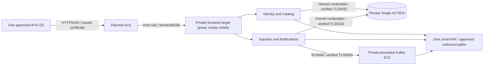

# Next AWS plan review — 28 October 2026

Historical preparation checkpoint. The five-create state bootstrap was subsequently approved and applied on29 October: [actual execution evidence](evidence/aws-state-bootstrap-2026-10-29/README.md). The local-backend HTTPS preview remains unapplied; see the [new actual S3-backed plan review](aws-s3-plan-review-2026-10-29.md).

The user selected one HTTPS client /32 for **plan preparation only**. The existing free hostname and issued nonexportable ACM certificate are verified again. No application infrastructure was provisioned by this work. The account is still Free/ACTIVE with $100 credits as of today's authenticated read-only check. Account/region: `772641336063` / `us-east-2`. [Evidence index](evidence/aws-https-plan-2026-10-28/README.md).

## Two concrete saved plans, two approval boundaries

| Plan | Actual result | Purpose / boundary |
|---|---|---|
| State bootstrap | 5 creates, 0 changes/destroys | One protected private S3 bucket with encryption, versioning, public-access blocks and TLS-deny; no OIDC. Requires approval before apply. |
| HTTPS infrastructure preview | 111 creates, 0 changes/destroys | Proposed ALB443 with actual certificate/hostname/approved client, private broker/RDS/NAT/discovery/secrets/logs/alarms; zero app task definitions/services. Local backend only; never apply this preview. |

The second plan differs from the historical 108-create hostname-free preview by the HTTPS listener, host-routing rule and one client ingress rule. Terraform definitions are unchanged; only private reviewed inputs changed. PostgreSQL 17.6 is pinned for this preview and appears in Ohio orderable metadata. That metadata and a successful plan do not prove every create permission/capacity in the Free account.

The state bucket does not exist yet. The final S3-backed application plan cannot be generated until approved bootstrap creates it. After bootstrap, initialize the exact state key `linked-in-node/ecs-dev/terraform.tfstate`, with `encrypt=true` and `use_lockfile=true`, and generate a NEW saved infrastructure plan from the actual backend. Review its account/region, current costs, source/input hashes, replacements/deletes and actual start/expiry proposal before provisioning. The existing certificate stays in its separate preserved local state; do not migrate/delete it implicitly.

The proposed expiry tag is planning metadata, not a timer or deletion job. Refresh it at the actual agreed start, then arrange the selected 24-hour teardown before billable application resources start. No demo clock has started. State storage/retention is a separate explicit residual decision.

## Dated cost comparison

All 31 selected price rates/units were rechecked against official Ohio catalog SKUs or primary public tariffs on 28 October; no amounts changed. Preserved raw retrievals remain in ignored private work, with source hashes in the receipt. Fourteen old keys omitted tier bounds; the refresh records current bounds without falsely claiming a historical tier comparison.

| Scope | Hours | Idle | Expected | Higher use |
|---|---:|---:|---:|---:|
| Current HTTPS infrastructure preview | 24 | $5.94 | $6.83 | $21.14 |
| Current HTTPS infrastructure preview | 720 | $164.29 | $191.22 | $622.19 |
| Future five-task activation | 24 | $7.43 | $8.32 | $22.62 |
| Future five-task activation | 720 | $208.76 | $235.68 | $666.66 |

Gross USD before credits/shared free allowances; assumptions, not spending caps. Restore exercises, domain services outside the free hostname, taxes and non-AWS tool costs remain separate. [Exact itemized ledgers](evidence/aws-https-plan-2026-10-28/https-preview.json) include compute/storage, ALB/LCUs/IPv4, NAT/gateway traffic, RDS/backup/CPU-credit sensitivity, logs/metrics/alarms/queries, seven secrets/KMS calls, registry/S3/private-DNS and data transfer. No new public Route53 zone, customer KMS key, MSK, WAF or security-service enablement is proposed.

The new HTTPS probe stage retains a conservative idle/expected/higher LCU and internet-response envelope for permitted TLS/403/503 checks. The older no-listener stage zeroed those meters. This changes expected staging from $6.71 to $6.83/24h; the future five-task estimate remains $8.32. Stage traffic is an allowance, not a marketplace load claim.

State allocation is carved from the existing shared S3 meter: 1 GB of versioned state plus 1 PUT/LIST and 10 GET requests per hour; operations receive the remaining 9 GB / 9 PUT / 90 GET. Its modeled share is approximately $0.00097/24h or $0.0292/720h, already included rather than added again. There is no bucket-hour fee. S3 requests, retained versions and bootstrap artifacts can persist after app teardown; these small allowances are not caps. Review removing the protected bucket only after all dependent infrastructure is destroyed and required state is retained offline.

## Proposed ingress and traffic boundaries



Only the user-approved /32 gets 443 to the ALB. Unknown hosts get a fixed 403. The selected host forwards only to the frontend target group; there is no HTTP listener, SSH, public database/Kafka or direct public backend path. The actual client address stays in mode0600 private inputs/plans, not committed documentation. Private API HTTP hops remain explicitly documented; database/broker clients verify TLS. Single-AZ backend/DB/Kafka remain recovery compromises, not end-to-end high availability.

Zero app tasks means the expected-host route can return 503 until image publication, secrets, database bootstrap and separate activation are completed. TLS listener success or a fixed 403 does not prove the marketplace is functional. Task/execution roles are defined for the later image stage; only the broker role/profile is planned now. Secrets are metadata resources with no values in Terraform. Broker reads may retry while its empty secret awaits approved configuration.

## Security checker and actual evidence

The offline reviewer retains default strict hostname-free mode. `--https-context` explicitly selects a private approved /32/hostname/issued-certificate context; `--rates-file` selects today's preserved tariffs. It verifies actual saved-binary JSON, embedded *.tf/provider-lock bytes, the separately preserved broker template, and owner-only inputs. It checks encrypted/private/protected data resources and zero app tasks, binds exact SG owner/peer/port/for_each references while IDs are unknown, and binds ALB→listener→host rule→frontend target group. Neither this script nor its tests apply resources.

The independent critic reproduced three checker bypasses against unsafe stubbed JSON while confirming actual source/plan safety. Those bypasses now fail: wrong HTTPS owner SG, wrong database source SG and wrong target group. Additional checks bind listener ownership/rule attachment and plan privacy. The suite first accepts the real valid fixture, then rejects 23 HTTPS controls and 11 legacy controls. No gate was removed or relaxed. Full source/plan hashes and test outputs are linked in the evidence index. The generated IAM operator draft still has 12 wildcard warnings and is not attached or used; it is separate from the scoped broker role in this plan.

Reproduce the private review from the repository root (no AWS calls/apply):

```bash
python3 scripts/aws-ecs-review-plan.py \
  --plan-json work/aws-https-preparation-2026-10-28/https-plan.json \
  --plan-binary work/aws-https-preparation-2026-10-28/terraform/https-preview.tfplan \
  --https-context work/aws-https-preparation-2026-10-28/https-review-context.json \
  --rates-file docs/evidence/aws-https-plan-2026-10-28/rates.json \
  --report work/aws-https-preparation-2026-10-28/recheck.json
```

Use the same effective credential environment for STS and any later approved Terraform operation; immediately verify account/region and the exact approved saved-plan hash. A CLI-only profile override may differ from Terraform's inherited credentials. Never apply the historical/local preview or generated operator policy as a substitute for the final reviewed plan.

[Final independent verdict](evidence/aws-https-plan-2026-10-28/critic.md): preparation review passes; provisioning and deployment remain unapproved. The next concrete decision is the five-create state bootstrap.

## After approved provisioning

From the allowed network, the first ALB-only TLS probe can preserve Host/SNI without pinning an IP:

```bash
curl --show-error --connect-to \
  "app.linked-in-node-rv.dynv6.net:443:ACTUAL_ALB_DNS:443" \
  -o /dev/null -w '%{http_code}\n' \
  https://app.linked-in-node-rv.dynv6.net/health
```

A 503 is expected with an empty target group; require successful certificate validation, not `curl -k`. After separately approved exact-source image publication, secret population, owned-DB bootstrap and activation, add the actual application CNAME and require target health, browser journeys and all 48 AWS API checks. Verify unauthorized client denial, private DB/broker/role denial, CloudWatch emission/alarm state/delivery when configured, broker replay, isolated DB restore with measured RPO/RTO and bad-release rollback. First deployment has no prior successful ECS release to roll back to. Image rollback cannot undo destructive migrations, key rotation or lost writes.

At 24 hours after the agreed billable app start, follow the reviewed teardown/retention plan. Delete ALB/NAT/EIP and running compute/database resources; stopping alone leaves costs. RDS protection/final snapshots/automated backups, S3 versions, secret recovery windows, ECR/log retention and protected state cleanup require explicit decisions. [Complete operations/rollback/cleanup guide](aws-ecs-dev.md).
