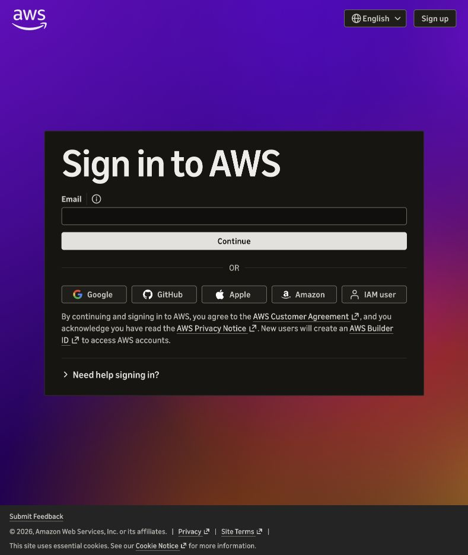

# Recognize AWS sign-in and identity

[Visual guide](README.md) · [Console service examples](02-console-service-examples.md)

## Actual captured screen: email-based AWS sign-in

**Provenance:** actual browser capture, 28 October 2026. The email field was empty; no password, token, account menu or private browser content is pictured. This is an authentication entry page, not a signed-in service screenshot or proof of project resources.

1. **Email / Continue:** use the same email identity you originally registered with.
2. **Google/GitHub/Apple/Amazon:** choose the original provider if that is how you registered. A provider choice is not an IAM username.
3. **IAM user:** opens a different login requiring an existing account identifier, username and console password. An AWS role name is not a username.
4. **Sign up:** creates a new identity/account path; it is not the way to reopen the existing project.

The earlier browser page defaulted to IAM-user sign-in. Selecting **Change to new experience** exposed this email/provider view. After signing in, select the existing project/account and Ohio (`us-east-2`) before interpreting regional service lists. Never include typed sign-in credentials in study screenshots.

## The account check that explained the confusion

A read-only check on 28 October returned project account `772641336063`, an assumed-role session whose role name was `AccountFullAccessRole`, and an empty IAM user list. This does not reveal or create a password. It establishes that the checked CLI identity was a role session and there were no IAM users returned in that account at that time.

| Term | Small explanation |
|---|---|
| Account ID | Twelve-digit identifier for the AWS account |
| IAM user | A named identity created inside an account; none were returned by the check |
| Role | Permissions assumed for a session; `AccountFullAccessRole` is a role name |
| Temporary session | Time-limited credentials used by the CLI/console role session |
| Root user | A distinct account-owner identity in the traditional account model; an administrator role is not automatically root |
| AWS Builder ID/new experience | Email/provider identity and project access, rather than an IAM console password |

The observed role session is consistent with the new account experience, but the CLI ARN alone does not identify the human login provider. Confirm the original sign-in method in the browser. AWS documents that the new experience does **not** permit IAM users with console access; it uses project/team access instead. Do not create a long-lived key or attach AdministratorAccess merely to get through the wrong sign-in form. See [IAM users and the new experience](https://docs.aws.amazon.com/IAM/latest/UserGuide/id_users_create.html) and [account-model comparison](https://docs.aws.amazon.com/accounts/latest/reference/sign-up-for-aws.html).

## If you need another human identity later

For a new-experience project, an authorized owner uses **AWS Settings → Team → Invite new team member**, chooses the intended project and reviews the permission impact before sending. AWS's current model gives invited members administrative resource access to shared projects; it is not a read-only screenshot identity. This guide did not send invitations or create users. [Official team instructions](https://docs.aws.amazon.com/accounts/latest/reference/invite-team-members.html).

For a traditional account that supports IAM console users, the generic path is **IAM → Users → Create user → enable console access → assign reviewed group permissions → configure password → review/create → MFA**. That is a conditional explanation, not a recommendation to create an administrator here. Prefer federation/temporary credentials for human access, and create only credentials required for the chosen use case. The exact account model and permission scope must be decided before making an access change. [AWS identity guidance](https://docs.aws.amazon.com/IAM/latest/UserGuide/best-practices.html).

**Recall:** Why will entering `AccountFullAccessRole` in the IAM username box fail? Which part of the read-only check proves the account identifier, and which part proves that no IAM users were listed?

## A different screen: IAM user creation

The user later supplied an actual **IAM → Create user → Set permissions** screenshot. This is a creation wizard, not the email sign-in page pictured above. The assumed CLI role alone did not establish the account’s sign-up model or whether an IAM console password can be enabled. Read [the exact permissions-screen walkthrough](03-iam-user-permissions.md), then verify Step 1’s console-access option before assuming a newly created identity can sign in. Seeing this wizard does not by itself prove console-password support.
