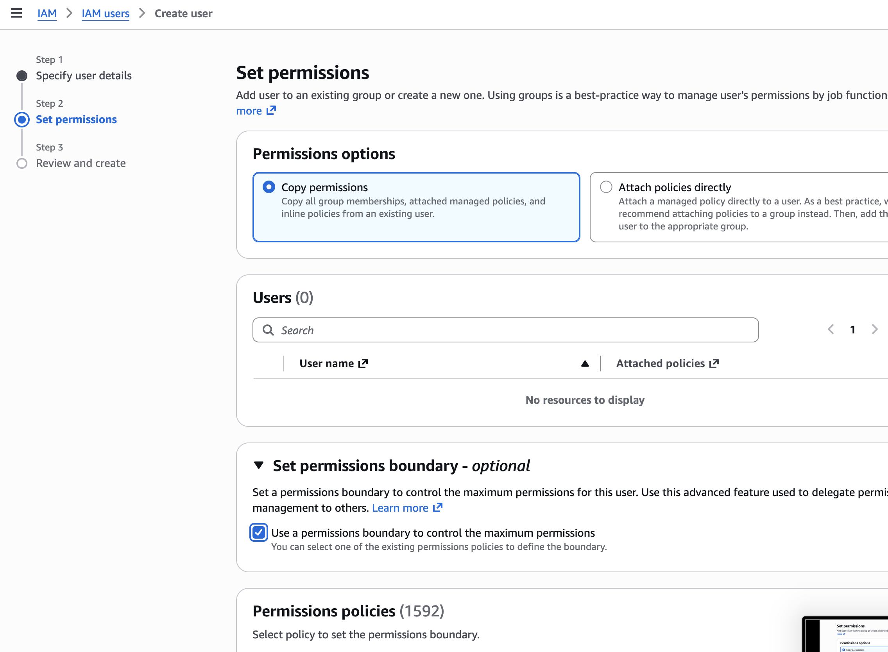

# Your IAM “Set permissions” screen

[Visual guide](README.md) · [Sign-in versus role identity](01-sign-in-and-identity.md)

**Provenance:** screenshot supplied by the user on 28 October 2026, copied without editing. The account, Region, proposed username and Step 1 settings are not visible. This is a wizard in progress, not evidence that a user was created or can sign in. The small lower-right thumbnail is part of the supplied image.

## 1. Recognize the step you are on

The left-hand navigation shows **Step 2: Set permissions**. It is not the IAM login page, and it is not the email/provider sign-in page in the previous card. That difference explained why the earlier screen instructions did not match what the user saw.

The CLI check's assumed `AccountFullAccessRole` session did not prove which signup experience this browser/account uses. Work from the actual UI and verify the console-access setting instead of inferring it from a role name.

## 2. “Copy permissions” needs an existing user

Copy permissions duplicates an existing user's group memberships and attached/inline policies. The visible list says **Users (0)**, so there is no displayed source to select. Remaining on this option does not grant useful permissions to the new identity.

For the one study/screenshot identity discussed here, select **Attach policies directly**. AWS generally recommends managing users through groups; a reviewed study group with the same policies is preferable when managing several users. The instructions below use the attachment option actually visible in this screenshot.

## 3. Attach viewing policies for the current task

Search the permission-policy list and select these exact AWS managed policies:

| Policy | What it contributes | What it does not authorize |
|---|---|---|
| `ViewOnlyAccess` | Broad resource lists and basic metadata for study | It is not a Terraform deployment/operator policy and may not expose every detail page |
| `AWSCertificateManagerReadOnly` | ACM certificate descriptions, lists and other certificate read operations | It does not request/delete certificates or provision application resources |

[ViewOnlyAccess policy](https://docs.aws.amazon.com/aws-managed-policy/latest/reference/ViewOnlyAccess.html) · [ACM read-only policy](https://docs.aws.amazon.com/aws-managed-policy/latest/reference/AWSCertificateManagerReadOnly.html).

These are a convenient AWS-managed starting point for viewing services in this learning account, not a narrowly resource-scoped production policy. Additional console panels can still require separately reviewed read permissions. Do not solve a missing detail by immediately attaching `AdministratorAccess`. The pending Terraform/deployment operator role is a separate task owned by the deployment chat.

## 4. The checked boundary is a ceiling, not a grant

The screenshot shows **Use a permissions boundary to control the maximum permissions** checked. The policies displayed below that section select the ceiling; they are not the identity's access grants.

For this new basic study-only user, leave the optional boundary unchecked unless the account administrator requires a specific boundary. This instruction concerns an uncreated identity's optional setting; it does not remove an established account guardrail. If a boundary is required, retain it and have the administrator choose an appropriate ceiling. Allowed identity-policy actions must also fit inside that boundary; other policy controls can restrict them further. [AWS boundary explanation](https://docs.aws.amazon.com/IAM/latest/UserGuide/access_policies_boundaries.html).

Selecting a boundary without attaching an access policy does not grant the permissions in that boundary. Selecting only `ViewOnlyAccess` as a boundary could also restrict the additional ACM read operations you intended to grant.

## 5. Check console access before completing creation

Return to **Step 1: Specify user details** and verify whether **AWS Management Console access** and password setup are available/enabled. A user created for programmatic access alone does not automatically get a browser password.

If console access is unavailable, stop this console-user path and use the supported original email/provider/federated sign-in. AWS documents that the new project-account experience does not support IAM users with console passwords. The existence of this creation wizard does not contradict that restriction: IAM identities can also be programmatic. [IAM creation and account-model guidance](https://docs.aws.amazon.com/IAM/latest/UserGuide/id_users_create.html).

If this account supports IAM console users, review the username, console access and the two intended policy attachments before creating it. Set the password through the AWS UI, use the current authorized admin session to assign MFA, and keep credentials out of screenshots/Git. Do not create access keys just for browser viewing. These are user-operated setup instructions; the documentation agent has not created a user, password, MFA device or access key.

## 6. Verify access with a small task

After an authorized creation/sign-in, confirm the expected account, select Ohio for regional services, and open the certificate detail page. A successful page view proves that specific read operation; it does not prove full deployment permission or that planned infrastructure exists. If access is denied, inspect the exact service/action and applicable policies rather than switching to unrestricted access.

**Recall:** Why is the current Users (0) list empty? What is the difference between selecting `ViewOnlyAccess` as an attached policy and as a boundary? Which Step 1 setting determines whether this new identity can use a password to sign in?
