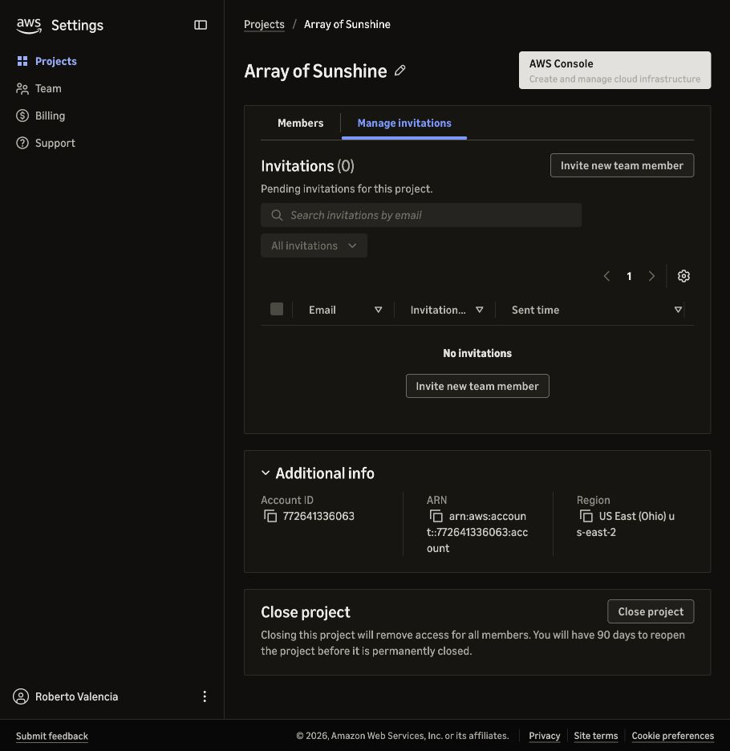
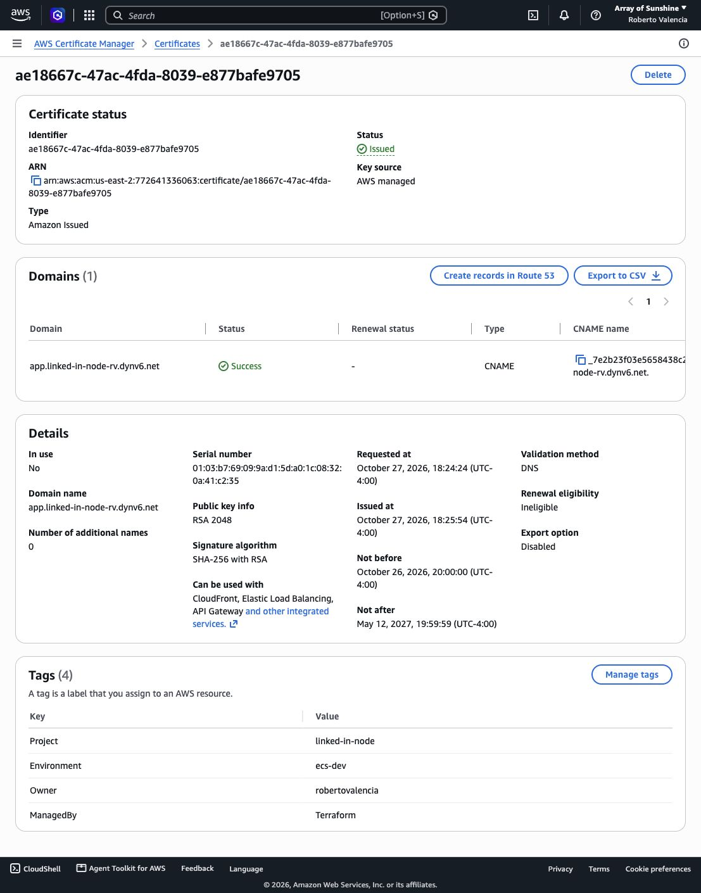
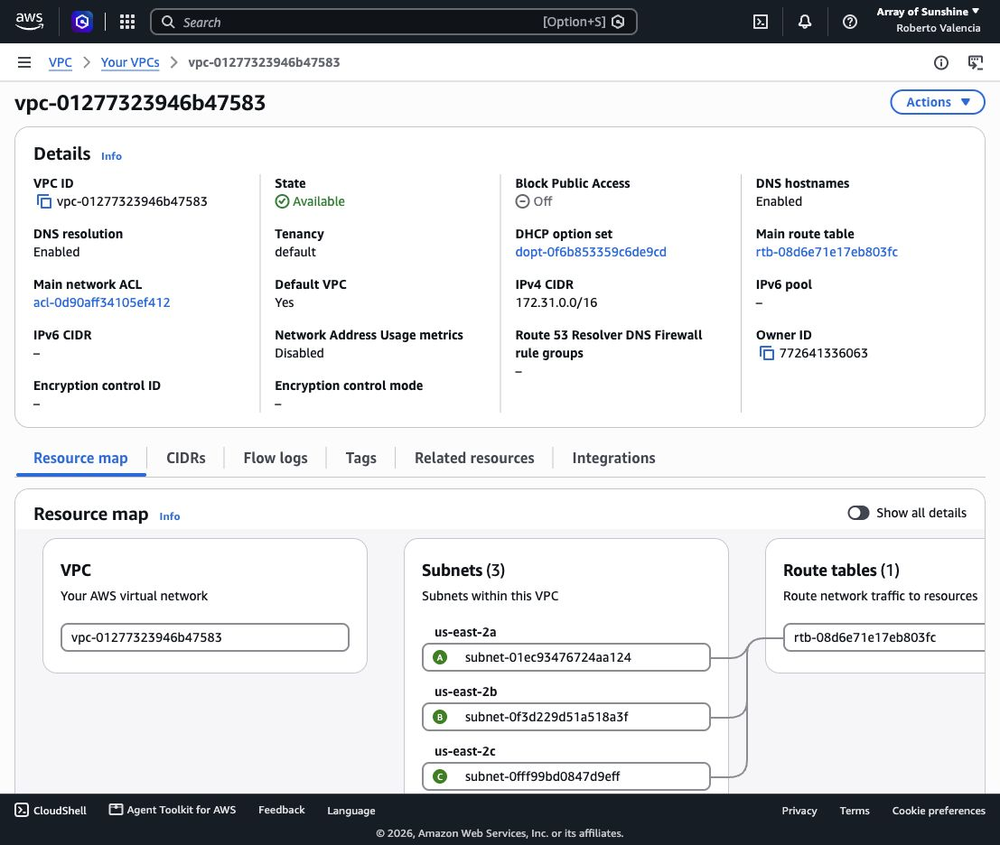
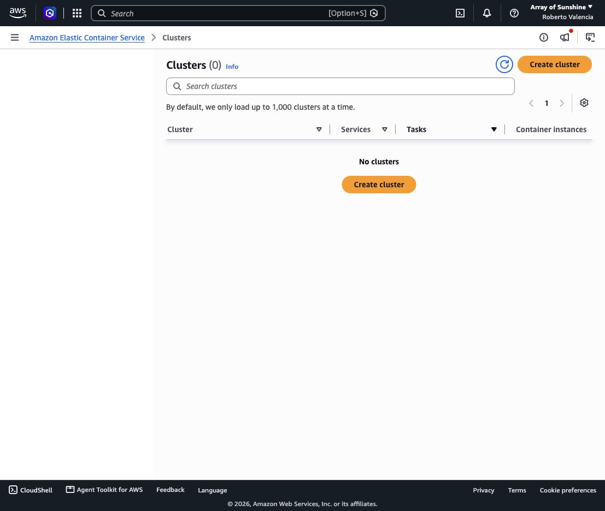
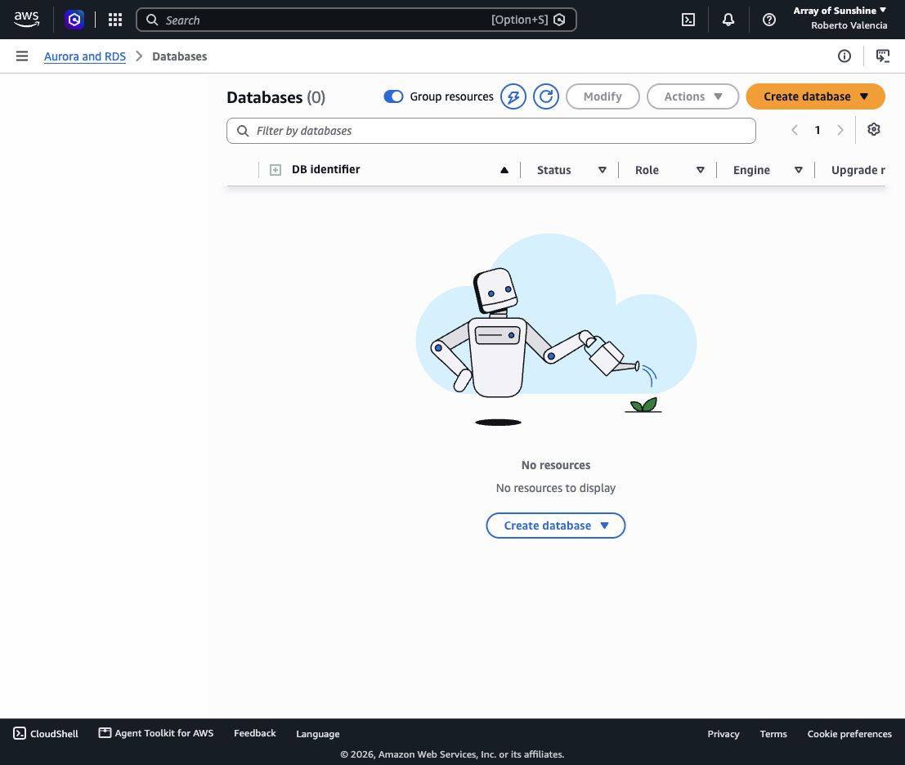
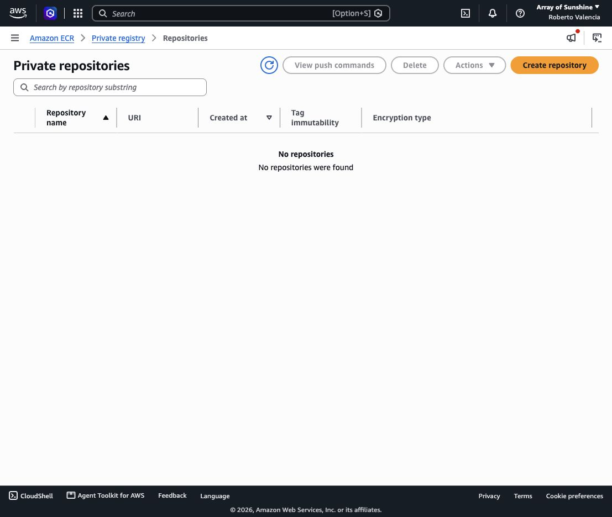
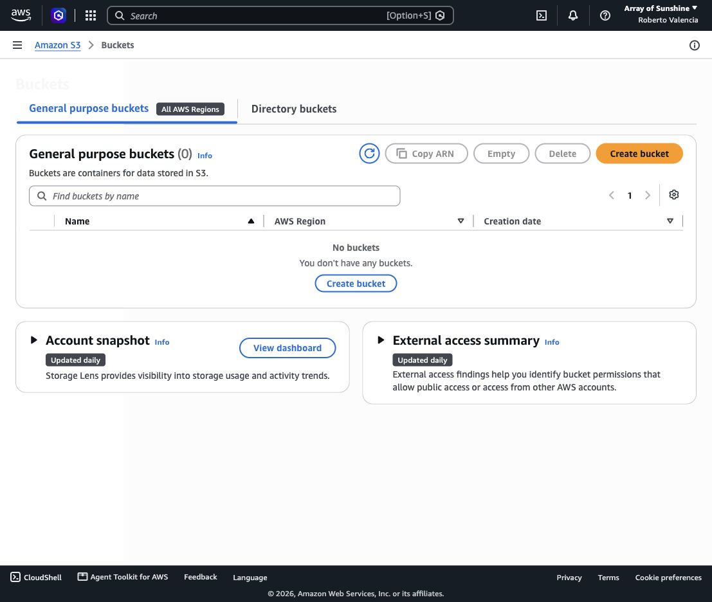
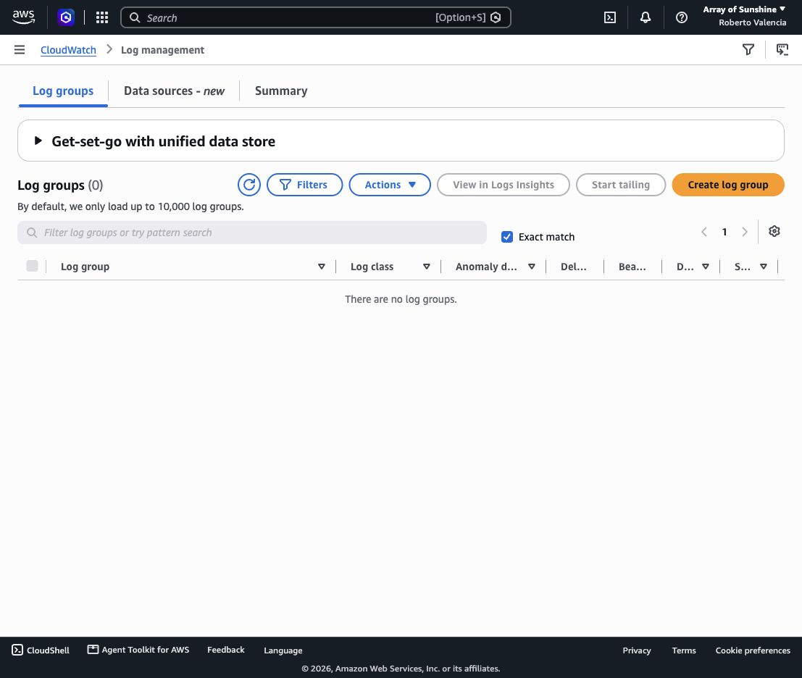
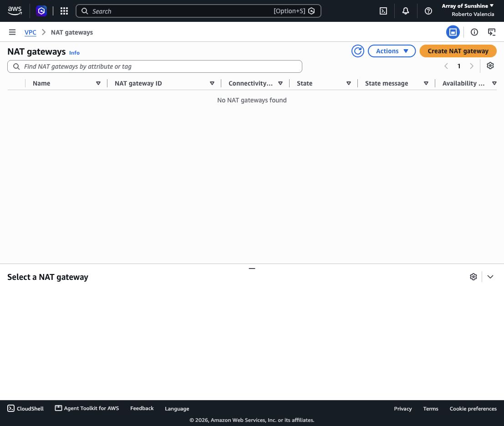
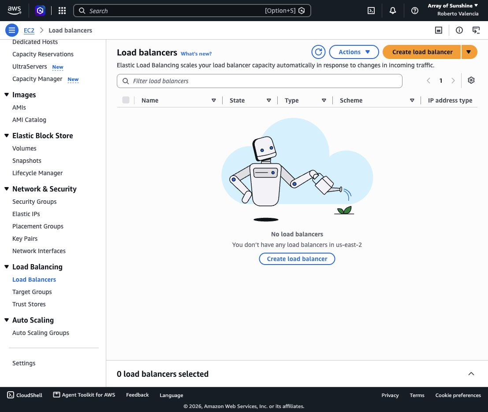

# Actual Array of Sunshine console captures

[Visual guide](README.md) · [Official examples for comparison](02-console-service-examples.md) · [Setup process](../walkthroughs/README.md)

These are genuine signed-in browser captures from **Array of Sunshine**, collected read-only on **28 October 2026**. They are separate from the official AWS example screenshots. Source files describe the planned configuration; these images describe what the console displayed at capture time. No resource was created or modified to produce them.

The project page identifies account `772641336063` and Ohio (`us-east-2`). Most captured service views use that regional project context. The S3 view is an explicit exception: its **general-purpose bucket tab says All AWS Regions**. Counts are scoped to the visible tab, filters, account permissions and capture time; they are not a full billing or all-service inventory. No screenshot contains a password, MFA seed/code, recovery email, device/IP history or the private approved client address. Some wide tables/maps extend beyond the viewport; absence from a clipped edge is not absence from AWS.

## 1. Project: the account is the resource boundary

**What is visible:** the existing project name, its account identifier/ARN, Ohio Region, console-entry button and **Invitations (0)** on the selected **Manage invitations** tab. That count is pending invitations, not a count of project members or IAM users.

**Small concept:** AWS Settings manages project/team identity. The AWS Console link enters the project's resource console under its existing role. Personal sign-in/MFA settings live in the profile menu; they are not configured through the invitation table.

**Project connection:** [identity/setup walkthrough](../walkthroughs/03-aws-identity-and-costs.md). The sidebar Billing and Close project controls were not used.

**Recall:** Does zero pending invitations mean there are zero identities able to access the project?

## 2. ACM: issuance is complete; application HTTPS is not

**What is visible:** the certificate for `app.linked-in-node-rv.dynv6.net` is **Issued**; domain validation is **Success**; **In use: No**; **Renewal eligibility: Ineligible**; **Export option: Disabled**. Its tags identify the project/environment and Terraform management. These tags are metadata, not proof of deployed application resources.

**Small concept:** domain control, certificate issuance, listener attachment and application readiness are four different gates. An issued unused certificate establishes the first prerequisites, not the later gates. The wide validation table clips portions of CNAME fields; use the recorded issuance data rather than transcribing a partial value from the picture.

**Project connection:** [DNS/certificate walkthrough](../walkthroughs/05-hostname-dns-and-certificate.md) and [lesson 50](../generated/50-dns-route53-acm-and-tls.md). The existing certificate was opened only for reading; no request, export, deletion or DNS change was performed.

**Recall:** Which visible field prevents you from calling this screenshot proof of deployed application HTTPS?

## 3. VPC: an existing default network is not our planned network

**What is visible:** an **Available** VPC with **Default VPC: Yes**, IPv4 CIDR `172.31.0.0/16`, DNS settings and a resource map with three subnets in Ohio AZs. Some map connections fall outside the image's right/bottom edges. Do not infer that an internet gateway or other connection is absent simply because it is not pictured.

**Small concept:** AWS can have a pre-existing/default network while a separate application network remains only Terraform source. The prepared ECS root declares `10.85.0.0/16`; it is not the `172.31.0.0/16` VPC shown here. The older EC2 root declares another application CIDR. Match IDs/CIDRs/tags and evidence before assigning ownership.

**Project connection:** [47 · VPC addressing](../generated/47-vpc-cidr-ipv6-and-subnet-design.md) and the actual [planned network source](https://github.com/robertovalencia/linked-in-node-and-aws/blob/2d3e6fa5e49d085599e8bb1739e758d26aad5c5f/infra/aws-ecs-dev/network.tf). This resolves a scope distinction: older project-filtered inventory could exclude this default VPC without claiming the entire account had no VPCs.

**Recall:** Why does finding this default VPC not establish that the reviewed application Terraform plan was applied?

## 4. ECS: the cluster inventory is empty

**What is visible:** **Clusters (0)**, an empty search field and **No clusters** in the selected project's service view. This is an inventory observation, not a running application or service-health check.

**Small concept:** a cluster, task definition, running task and ECS service are distinct objects. A prepared task/service resource in Terraform does not populate this console until its owning plan is actually applied. A Create cluster button is an action available in the UI, not evidence that it was clicked.

**Project connection:** [53 · ECS](../generated/53-ecs-fargate-tasks-and-services.md) and [pending deployment gates](../walkthroughs/06-deployment-security-and-operations.md). Compare the empty real account with the official example's running tasks, keeping their provenance separate.

**Recall:** Can a successful Terraform validation create an ECS cluster?

## 5. RDS: planned PostgreSQL has no database row yet

**What is visible:** **Databases (0)**, no database search text and **No resources to display**. This does not exercise endpoints, credentials, TLS, connection pools, backups or recovery.

**Small concept:** schema/data readiness comes after provisioning and controlled bootstrap. The source's PostgreSQL settings are proposed configuration, not values read from a live database. The console's generic empty-state illustration does not represent a deployed DB engine.

**Project connection:** [57 · RDS/PostgreSQL](../generated/57-rds-postgresql-backups-and-failover.md). The documentation agent did not start RDS's creation, express configuration or credit tutorial.

**Recall:** What evidence would be needed beyond an Available database status to prove the inquiry service can use its own database safely?

## 6. ECR: no private repository images have been published here

**What is visible:** the **Private repositories** view reports **No repositories were found**. The screenshot does not inventory public repositories in other scopes.

**Small concept:** source, built image, registry repository and published image digest are successive artifacts. The absence of private repositories in this view means it supplies no evidence of a published application image. The prepared exact-source publisher is a separate owner-run operation, not a credential-free local lab.

**Project connection:** [26 · Docker/ECR](../generated/26-aws-docker-and-ecr.md) and [delivery walkthrough](../walkthroughs/06-deployment-security-and-operations.md). Compare with the official ECR example showing a tag and digest.

**Recall:** Does a local Docker build establish that ECR has the reviewed image?

## 7. S3: read the tab's scope, not only the URL's Region

**What is visible:** **General purpose buckets (0)**, **All AWS Regions**, no name filter and **No buckets**. The Directory buckets tab is separate; this image does not inventory every S3 bucket type, object or other account.

**Small concept:** a service view can be account/global in scope even when a URL includes `region=us-east-2`. Read the UI's actual scope. The unapplied state-bootstrap plan is a proposed bucket configuration, not an existing state object in this list.

**Project connection:** [36 · state/bootstrap](../generated/36-terraform-state-locking-and-bootstrap.md) and [Terraform setup](../walkthroughs/04-terraform-setup-and-plans.md). No bucket was created or emptied for this capture.

**Recall:** Why would it be inaccurate to caption this image “no S3 resources anywhere”?

## 8. CloudWatch: configuration and actual emitted logs are separate

**What is visible:** **Log Management → Log groups**, **Log groups (0)** and **There are no log groups**. This is not a screenshot of an alarm notification, CloudWatch agent health or application log delivery.

**Small concept:** log-group resources, emitters, streams/events and alarms each need distinct verification. Terraform source can describe them before any task or host has emitted a log. The console's Create log group or setup suggestion is not a step to execute just to populate the picture.

**Project connection:** [65 · logs/metrics/alarms](../generated/65-cloudwatch-agent-logs-metrics-and-alarms.md) and [67 · observability](../generated/67-otel-tracing-slos-and-incidents.md). No agent, alarm or paid telemetry feature was enabled.

**Recall:** Why can the presence of Terraform log-driver settings fail to produce any real log events?

## 9. NAT: no gateway is present in this list

**What is visible:** **NAT gateways**, no attribute/tag filter and **No NAT gateways found** in the selected project/Region view. No claims about NAT instances or another Region follow from this list.

**Small concept:** a private subnet's outbound route needs a real next hop, not merely a resource block in source. The default VPC seen earlier is not evidence that the proposed application NAT exists. A gateway's provisioning, connectivity and cost verification remain separate gates.

**Project connection:** [49 · private connectivity/NAT/endpoints](../generated/49-private-connectivity-nat-and-endpoints.md). Costs and deployment decisions remain with the owner chat; no gateway was created during documentation.

**Recall:** What route and next-hop observations would you need to prove private-task egress works?

## 10. Load balancers: the certificate has no deployed ALB here

**What is visible:** a blank load-balancer filter and **No load balancers — You don’t have any load balancers in us-east-2**. The list is the regional load-balancer view, not a CloudFront/API Gateway inventory.

**Small concept:** certificate issuance does not create an HTTPS listener or a load balancer. The earlier ACM **In use: No** is consistent with this empty load-balancer view, but each observation has its own scope. The source's ALB, listener and host-rule definitions remain planned; no listener/target health or request-routing test ran during this capture.

**Project connection:** [51 · ALB target groups](../generated/51-alb-target-groups-and-health-checks.md) and [delivery/security walkthrough](../walkthroughs/06-deployment-security-and-operations.md). No Create load balancer action was invoked.

**Recall:** Which additional live tests are needed after an approved ALB exists before declaring the marketplace available?

## Use the two galleries together

The [official examples](02-console-service-examples.md) show populated services and field meanings. This page shows the actual project's current resources and empty views. Neither gallery replaces the dated cost/plan review or authorizes provisioning. Subsequent deployment work should add new dated captures, preserving these as the pre-deployment baseline rather than editing images to appear populated.

## Direct code map

| Capture | Actual repository definition |
|---|---|
| ACM certificate | [infra/aws-ecs-certificate/main.tf](https://github.com/robertovalencia/linked-in-node-and-aws/blob/2d3e6fa5e49d085599e8bb1739e758d26aad5c5f/infra/aws-ecs-certificate/main.tf) |
| Planned application VPC/NAT/SGs | [infra/aws-ecs-dev/network.tf](https://github.com/robertovalencia/linked-in-node-and-aws/blob/2d3e6fa5e49d085599e8bb1739e758d26aad5c5f/infra/aws-ecs-dev/network.tf) |
| ECS/log groups/task drivers | [infra/aws-ecs-dev/compute.tf](https://github.com/robertovalencia/linked-in-node-and-aws/blob/2d3e6fa5e49d085599e8bb1739e758d26aad5c5f/infra/aws-ecs-dev/compute.tf) |
| RDS/ECR/secrets metadata | [infra/aws-ecs-dev/data.tf](https://github.com/robertovalencia/linked-in-node-and-aws/blob/2d3e6fa5e49d085599e8bb1739e758d26aad5c5f/infra/aws-ecs-dev/data.tf) |
| ALB/listener/host routing | [infra/aws-ecs-dev/ingress.tf](https://github.com/robertovalencia/linked-in-node-and-aws/blob/2d3e6fa5e49d085599e8bb1739e758d26aad5c5f/infra/aws-ecs-dev/ingress.tf) |
| Metric alarms | [infra/aws-ecs-dev/observability.tf](https://github.com/robertovalencia/linked-in-node-and-aws/blob/2d3e6fa5e49d085599e8bb1739e758d26aad5c5f/infra/aws-ecs-dev/observability.tf) |
| State-bucket bootstrap | [infra/bootstrap/main.tf](https://github.com/robertovalencia/linked-in-node-and-aws/blob/2d3e6fa5e49d085599e8bb1739e758d26aad5c5f/infra/bootstrap/main.tf) |
