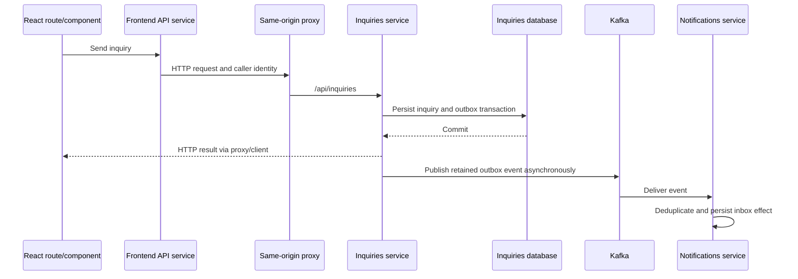

# 2 · From requirements to the working application

[Previous: local setup](01-local-setup.md) · [Index](README.md) · [Next: AWS identity and costs](03-aws-identity-and-costs.md)

## 1. Preserve a contract before replacing an implementation

The Node project replaced the Java backend while preserving the marketplace behavior. A **contract** is an observable agreement: URL, request fields, permissions, status codes and resulting data. A new framework is allowed to implement that agreement differently internally.

Read [CONTRACT.md](../../../CONTRACT.md) and [requirements](../../../docs/specs/requirements.md) before reading framework code. Pick “client sends an inquiry.” Write who may call it, what constitutes duplicate submission and what must survive a restart. These become acceptance criteria. The [migration explanation](../../../docs/interview-topics/java-to-nestjs.md) describes the technology mapping; it is separate from proof that a particular runtime check passed.

## 2. Follow one request across the layers



The diagram explains mechanism, not a new execution result. The outbox joins business data and the intent to publish in one database transaction. It avoids pretending a database commit and Kafka publication are a single atomic cross-system operation. Retry/deduplication behavior still needs tests.

Open [backend/src/inquiries](../../../backend/src/inquiries), [notifications](../../../backend/src/notifications) and the [architecture](../../../docs/architecture.md). Explain the successful path, then the failure after the database commits but before publication. See [lesson 09](../generated/09-inquiries-idempotency-and-outbox.md) and [lesson 10](../generated/10-kafka-inbox-and-notifications.md) for the code-level mechanism.

## 3. Give frontend files clear jobs

| Directory | Question it answers |
|---|---|
| [routes](../../../frontend/src/routes) | Which page assembles this journey? |
| [components](../../../frontend/src/components) | Which UI piece renders or handles interaction? |
| [services](../../../frontend/src/services) | How is HTTP called and failure translated? |
| [types](../../../frontend/src/types) | Which TypeScript shapes cross a boundary? |
| [contexts](../../../frontend/src/contexts) | Which shared state, such as authentication, spans pages? |
| [hooks](../../../frontend/src/hooks) | Which reusable state/effect behavior is extracted? |

A separate file has value when it gives a coherent responsibility a clear home. A file for every tiny function can make a request harder to follow. TypeScript shapes are erased at runtime, so the backend must validate incoming data and enforce ownership independently of the UI.

## 4. Use checks with different jobs

Run these from the repository root after installing backend/frontend dependencies as in chapter 1:

```bash
npm --prefix backend ci
npm --prefix frontend ci
npm run check
npm test
npm run build
npm run acceptance
```

`check` checks source rules/types. Tests execute unit/component behavior. Build produces runnable artifacts. Acceptance needs the integrated stack running on `localhost:8180` and exercises actual HTTP/data/event flows. Read [scripts/acceptance.mjs](../../../scripts/acceptance.mjs) before assuming a green process covers a particular requirement.

Browser journeys additionally need root tooling and the browser binary:

```bash
npm ci
npx playwright install chromium
npm run test:browser
```

These commands describe reproduction, not tests newly executed by this documentation update. Historical evidence lives in [results](../../../docs/results.md) and [testing](../../../docs/testing.md). Date and source revision matter.

## 5. Diagnose one layer at a time

A UI timeout can mean the proxy cannot resolve a backend, the backend cannot connect to a database, or the operation exhausted its time budget. Inspect the browser request, proxy/backend logs and the relevant dependency. Do not rewrite a React component to hide a persistent server failure.

**Understanding check:** Why can a TypeScript build pass while a caller can still access someone else's inquiry? Which check would prove ownership enforcement? Why can an inquiry exist before its notification arrives?
