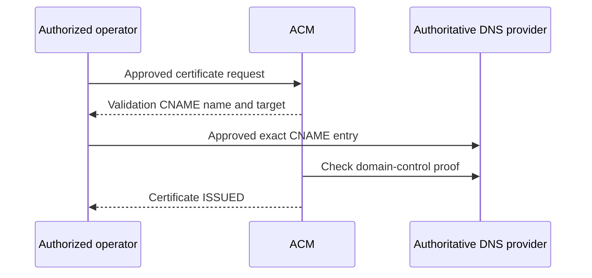

# 5 · Hostname, DNS and the TLS certificate

[Previous: Terraform setup](04-terraform-setup-and-plans.md) · [Index](README.md) · [Next: deployment and operations](06-deployment-security-and-operations.md)

## 1. A name and a server are separate things

A hostname is a human-readable label such as `app.example.com`. DNS records help clients find a destination. A name can exist before any application server is running. The owner registered the free test zone `linked-in-node-rv.dynv6.net` and selected its `app` child; [the hostname guide](../../../docs/aws-free-test-hostname.md) records that process.

That guide contains historical planning snapshots. Use the [28 October plan review](../../../docs/aws-https-plan-review-2026-10-28.md) for the later selected preview/cost assumptions. This chapter makes no new provider availability or price promise.

## 2. Control of DNS is different from AWS credentials

The DNS provider holds the zone records. ACM belongs to AWS. To validate a certificate, the operator must be authorized to update the name's authoritative DNS as well as request the AWS certificate. Owning one login does not grant the other permission.

The recorded workflow used a manual approved dynv6 browser entry. DNS was not silently added to the certificate Terraform root. The [root](../../../infra/aws-ecs-certificate/main.tf) requests the certificate and exposes validation metadata; the [issuance receipt](../../../docs/evidence/certificate-request/issuance.json) records the separate DNS operation.

## 3. A certificate binds a name to a public key

The certificate lets a TLS client verify the endpoint's identity and establish encrypted transport. A valid certificate does not authorize an application user or guarantee a healthy backend. The selected certificate uses the application hostname in `us-east-2`, matching the proposed regional ALB.

A conventional CloudFront viewer-certificate design uses a different certificate-location requirement. Do not move this regional certificate into a CDN plan by assumption; [lesson 50](../generated/50-dns-route53-acm-and-tls.md) covers that design distinction.

## 4. ACM gives a validation record

DNS validation asks the owner to publish an exact CNAME name/value pair. A **CNAME** makes one DNS name an alias of another. In this step the special underscore-prefixed name proves control of the requested domain; it is not the future application's normal traffic record.



Copy the provider-required record fields exactly, handling whether its UI expects a relative label or a full name. Adding the zone suffix twice makes a different record. Preserve the validation CNAME for renewal; issuance is not a signal to remove it. The [official ACM guide](https://docs.aws.amazon.com/acm/latest/userguide/dns-validation.html) explains this mechanism.

## 5. Verify at more than one DNS boundary

The owner matched the validation CNAME through the authoritative server and public recursive resolvers. The authoritative server holds the zone's answer; recursive resolvers can cache prior results. A provider UI success banner alone does not prove the public answer.

The safe read-only reproduction pattern is:

```bash
dig @ns1.dynv6.com CNAME VALIDATION_RECORD_NAME
dig @1.1.1.1 CNAME VALIDATION_RECORD_NAME
```

`VALIDATION_RECORD_NAME` is an explanation placeholder: substitute the exact non-secret public name from the issuance receipt before running. These are public DNS requests, not local-only tests or AWS changes. Compare the returned CNAME target, not just the command exit code. If results differ, check the zone/name/value and caching before requesting another certificate.

## 6. What the actual issuance proved

The [sanitized receipt](../../../docs/evidence/certificate-request/issuance.json) records one certificate added, DNS validation success, export disabled, no associated AWS service and a no-change post-issuance plan. Its [independent critic](../../../docs/evidence/certificate-request/issuance-critic.md) reviewed the actual result.

The certificate was unused; renewal was not yet eligible in that observation. No ALB or application deployment was created by that apply. Keep the private state that manages the certificate; deleting a local directory does not safely transfer resource ownership.

## 7. Know the next DNS record's different purpose

A future application CNAME would direct the `app` hostname to the actual ALB. That comes with the approved deployment/activation sequence. It does not replace the underscore-prefixed ACM validation CNAME. Successful TLS, target readiness and real browser/API journeys are later checks. The current certificate is a completed prerequisite, not a deployed marketplace.

**Understanding check:** Explain the two CNAMEs without notes. Can a certificate be issued while the application has no server? Why must the validation record remain after issuance?
