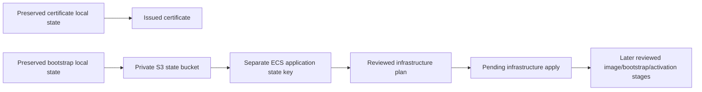

# 11 · Follow the actual AWS execution, one step at a time

[Walkthrough index](README.md) · [Local Terraform practice](09-terraform-local-commands.md) · [AWS command reference](10-terraform-aws-commands.md)

## What happened, and what is still pending

This journal records **29 October 2026**. The state bootstrap ran after explicit human approval. Application infrastructure has a reviewed saved plan but has not been applied. Application containers, public DNS routing, browser journeys and live recovery remain pending. Read the [actual owner review](https://github.com/robertovalencia/linked-in-node-and-aws/blob/ad2f2167496ec44f0583097d124ff18ddd311c0d/docs/aws-s3-plan-review-2026-10-29.md), rather than treating a code example as deployment evidence.

| Step | Purpose | Actual result / boundary |
|---|---|---|
| 1. Check CLI and existing profile | Know which tools and session will be used | AWS CLI 2.38.5; project credentials initially expired |
| 2. Renew the existing login | Obtain temporary credentials without permanent access keys | Owner-authorized `marketplace-login` renewal completed |
| 3. Verify effective identity | Confirm credentials reach the intended account | `marketplace-dev` resolved to account 772641336063 through AccountFullAccessRole |
| 4. Review and approve the bootstrap | Create storage for Terraform state independently of the application | Exact five-create saved artifact approved by the human |
| 5. Apply that bootstrap artifact | Create the state bucket and its protections | 5 added, 0 changed, 0 destroyed |
| 6. Read back actual controls | Test configuration rather than inferring it from source | Ohio, versioning, AES256, all four public-access blocks and TLS-only policy verified independently |
| 7. Initialize the real application backend | Keep application state separate from certificate/bootstrap state | S3 backend, isolated ECS key, encryption, locking, allowed-account binding and default workspace verified |
| 8. Save and inspect the application plan | Bind proposed changes to exact source, backend, inputs and prices | Original S3-backed plan: 111 creates, 0 updates/deletes, zero application tasks |
| 9. Reproduce the offline review | Inspect the saved artifact without cloud provisioning | Direct invocation passed before retention edits; historical wrapper now rejects source drift; modeled costs were $6.83/24 h for infrastructure, $8.32/24 h for later activation |
| 10. Set lifetime and retention | Avoid treating a tag or budget alert as a shutdown system | Human chose 24 hours, delete demo data at teardown, preserve Terraform state; mechanism/revised plan pending |
| 11. Apply, activate, test and clean up | Prove the running system and close its billable resources | Pending separate exact-plan review/approval and operational gates |

The [bootstrap apply transcript](https://github.com/robertovalencia/linked-in-node-and-aws/blob/ad2f2167496ec44f0583097d124ff18ddd311c0d/docs/evidence/aws-state-bootstrap-2026-10-29/apply.txt), [authenticated control read-back](https://github.com/robertovalencia/linked-in-node-and-aws/blob/ad2f2167496ec44f0583097d124ff18ddd311c0d/docs/evidence/aws-state-bootstrap-2026-10-29/verification.json) and [independent critic](https://github.com/robertovalencia/linked-in-node-and-aws/blob/ad2f2167496ec44f0583097d124ff18ddd311c0d/docs/evidence/aws-state-bootstrap-2026-10-29/critic.md) document completed steps. Do not rerun bootstrap against a new empty local state. Preserve its private working directory and the separate certificate state.

## Visible commands and iTerm

The desktop computer-use tool refused control of iTerm (`com.googlecode.iterm2`). No command was sent to that application, and no alternate UI automation was used. Commands were shown and run through the agent's shell instead. You may manually paste the safe inspection commands below into your own iTerm session. Terraform plans/state and private inputs stay outside the published study archive.

### A. Confirm the working directory and tools

```bash
(
  set -eu
  cd /Users/robertovalencia/Documents/Business/linked-in-node-and-aws
  pwd
  git status --short
  git rev-parse HEAD
  terraform version
  aws --version
)
```

`cd` selects the real project. A clean Git status is blank. The revision records what is being examined; later documentation commits need not alter the Terraform source embedded in the plan. Our recorded Terraform version was 1.17.0 on darwin_arm64. It reported 1.17.1 available; we kept the reviewed tool/provider selection. This is an observation, not an instruction to upgrade during deployment.

### B. Check the project identity after login

```bash
aws sts get-caller-identity \
  --profile marketplace-dev --region us-east-2 \
  --query Account --output text --no-cli-pager
```

Expected account: `772641336063`; stop and consult the owner if it differs. This read-only command does not deploy anything. The CLI profile is a local name; the returned account is evidence. The project profile obtains temporary credentials through `marketplace-login`; do not overwrite that relationship with an unrelated default profile. An expired session needs the authentication workflow and browser interaction. Never paste access keys, session tokens or MFA codes into the journal.

### C. Recheck the original saved plan without applying it

This is the **original reviewed application artifact**, before any lifetime/retention changes. The command deliberately requires the original plan hash. It stops if a revised plan replaced that file. During this documentation review the deployment owner began editing `data.tf` to implement the selected data-deletion policy. Rechecking the old artifact then correctly stopped with `Saved plan source differs: data.tf`. That is the expected current refusal: obtain the newly reviewed plan rather than forcing this historical artifact through the checker. Do not reset the owner’s changes, regenerate JSON in isolation or weaken checks to make the old binary pass. Private owner files must still be present; the ZIP is a study pack, not a bundle of credentials or deployable private plans.

```bash
(
  set -eu
  umask 077
  cd /Users/robertovalencia/Documents/Business/linked-in-node-and-aws
  STUDY_PLAN="$(pwd)/work/aws-s3-plan-review-2026-10-29/application.tfplan"
  test -f "$STUDY_PLAN"
  test "$(shasum -a 256 "$STUDY_PLAN" | awk '{print $1}')" = \
    "8cf376c7e79bd48c459c9892eecc111e02a352d8cfd10dd8723a35eaae2c9625"
  STUDY_REVIEW_DIR="$(mktemp -d "${TMPDIR:-/tmp}/marketplace-plan-study.XXXXXX")"
  chmod 700 "$STUDY_REVIEW_DIR"
  /opt/homebrew/bin/python3.12 scripts/aws-ecs-review-plan.py \
    --plan-json work/aws-s3-plan-review-2026-10-29/plan.json \
    --plan-binary "$STUDY_PLAN" \
    --https-context work/aws-s3-plan-review-2026-10-29/https-context.json \
    --s3-backend-context work/aws-s3-plan-review-2026-10-29/s3-backend-context.json \
    --rates-file docs/evidence/aws-s3-plan-2026-10-29/rates.json \
    --report "$STUDY_REVIEW_DIR/review.json"
)
```

`set -eu` stops this block on a failed guard/command or unset variable. A unique private directory avoids overwriting an earlier review. The checker decodes the actual binary with `terraform show`, compares embedded configuration/provider lock, validates source/network/backend bindings and computes costs. It never invokes `terraform apply`, AWS login or resource creation. It still starts the local provider process to decode schemas; “offline” does not mean “no subprocess.”

The direct reviewer invocation was actually run in the learning chat **before the retention source edits**. Recorded successful output:

```text
https_probe_infrastructure_NO_APP_TASKS 24h $6.83
https_probe_infrastructure_NO_APP_TASKS 720h $191.22
future_five_task_activation_NOT_PLANNED 24h $8.32
future_five_task_activation_NOT_PLANNED 720h $235.68
```

The report output path varies. These are modeled gross costs before credits, taxes and recovery exercises; usage assumptions are not spending limits. The future five-task line is a scenario, not an approved activation plan. [Source prices and itemized quantities](https://github.com/robertovalencia/linked-in-node-and-aws/blob/ad2f2167496ec44f0583097d124ff18ddd311c0d/docs/evidence/aws-s3-plan-2026-10-29/plan-review.json) explain the difference.

The first restricted attempt failed with `Failed to load plugin schemas` / `Unrecognized remote plugin message`. The unchanged command passed when retried with the required local execution permission. Do not infer a corrupt provider or upgrade/reinitialize state from that error alone. On your own machine, inspect permissions, architecture and the provider's diagnostic output if the error persists.

## The actual state boundaries



State bucket: `772641336063-linked-in-node-terraform-state`. Application key: `linked-in-node/ecs-dev/terraform.tfstate`. The bootstrap state does not automatically move itself into the bucket it created. An empty application key before first apply is expected. Planning briefly acquires/releases the S3 lock; that does not mean the 111 resource changes were applied. [Actual initialization receipt](https://github.com/robertovalencia/linked-in-node-and-aws/blob/ad2f2167496ec44f0583097d124ff18ddd311c0d/docs/evidence/aws-s3-plan-2026-10-29/backend-initialization.json).

## What must be resolved before the next apply

The human selected **24 hours, delete demo data at teardown, preserve Terraform state**. That choice does not silently change the original saved plan's RDS final-snapshot/deletion-protection/backup settings. The deployment owner must prepare the required reviewed transitions and distinguish data removal from resources with recovery windows or asynchronous deletion. An old snapshot-retaining artifact must not be applied as if it implemented a new deletion policy.

The 24-hour clock starts at the first billable application-resource creation. A real teardown mechanism and its operator must be agreed before that start. Temporary CLI credentials can expire before teardown; the operator must verify session lifetime and renew them when needed. A Mac timer cannot guarantee execution while asleep/offline, and an expiry tag never deletes resources. Operator-assisted cleanup needs a human and renewed credentials; AWS-side automation requires its own reviewed permissions, implementation and costs. Final retention of state, certificate and unavoidable residue must be explicit.

After the exact refreshed plan/current-cost/schedule approval, the owner rechecks identity/source/hash/backend and applies only that artifact. Infrastructure with an empty target group can return 503 without serving a usable UI. Exact-source images, secrets outside Terraform, owned-database bootstrap and later activation still follow. Only real target health, browser/API journeys, security denials, recovery and teardown checks establish a working AWS deployment. [Operational runbook](https://github.com/robertovalencia/linked-in-node-and-aws/blob/ad2f2167496ec44f0583097d124ff18ddd311c0d/docs/aws-ecs-dev.md).

## Explain it in an interview

“First I separated Terraform state ownership from application provisioning. We explicitly approved and verified the state bucket, then initialized an isolated encrypted, locked application backend. I inspected an exact saved plan and its source/security/cost bindings. I kept approval, apply, application activation and runtime verification as separate facts. A fixed-duration demo also needs real teardown execution and a deliberate data policy; metadata and budget alerts do not perform cleanup.”

Check yourself: Why is a successful plan not a working UI? Why preserve the bootstrap state? Why does changing retention require plan review? What happens if the operator's credentials expire before the shutdown deadline? Which checks above changed AWS, and which only inspected it?
