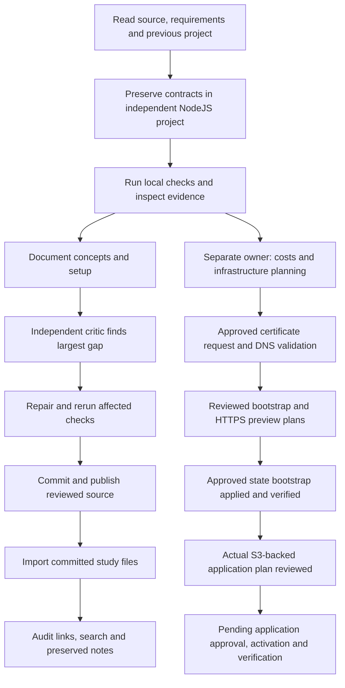

# How this project was set up and verified

This is the small-concept companion to the [84-lesson study path](../README.md). The lessons explain individual technologies; these chapters connect them to the actual work. Read one chapter, inspect its linked file, and explain the result aloud before continuing. You can read everything on GitHub without running AWS or enabling AI.

## Read in this order

| Chapter | The question it answers | Practice boundary |
|---|---|---|
| [1 · Tools, credentials and local startup](01-local-setup.md) | What do I install, and what does each setup command do? | Local containers; no AWS |
| [2 · From requirements to the working application](02-project-and-application-flow.md) | How did the migration preserve behavior? | Source inspection and local tests |
| [3 · AWS identity and cost-first decisions](03-aws-identity-and-costs.md) | Which account, permissions and cost assumptions matter? | Owner-run account checks; no new cloud actions here |
| [4 · Terraform roots, state and plan review](04-terraform-setup-and-plans.md) | Why are there separate plans, state files and approval steps? | Local labs; cloud apply remains gated |
| [5 · Hostname, DNS and TLS certificate](05-hostname-dns-and-certificate.md) | What did certificate setup actually achieve? | Recorded issuance; public DNS reads only |
| [6 · Deployment, network security and recovery](06-deployment-security-and-operations.md) | What must happen before the application is really deployed? | Future owner-run work, explicitly pending |
| [7 · How we built and reviewed the learning path](07-building-and-reviewing-the-study-path.md) | How were lessons, labs and evidence produced? | Local author/reviewer workflow |
| [8 · GitHub publication and Study Desk setup](08-publishing-and-study-desk.md) | How do these Markdown files reach GitHub and the reader? | Local reader and Git operations; no paid AI needed |
| [9 · Runnable Terraform commands](09-terraform-local-commands.md) | What do I type, and what should happen after each command? | Isolated local built-in-resource exercise |
| [10 · AWS Terraform command workflow](10-terraform-aws-commands.md) | How do bootstrap, the S3 backend, plan review, apply and GitHub triggers fit together? | Owner-operated templates; actual cloud execution/approval remains separate |

| [11 · Actual AWS execution journal](11-aws-execution-journal.md) | What actually ran, what did it prove, and what remains before application apply? | Verified bootstrap and offline review; pending application execution |

Each chapter ends with a small understanding check. It is fine to look up an answer. The objective is to connect a command to its purpose and evidence, rather than memorize a command sequence.

## The sequence we actually followed

The migration history is recorded in [requirements](https://github.com/robertovalencia/linked-in-node-and-aws/blob/8cb1c13bc3e42f06930ce8c7f1bb6a8aa3c08b61/docs/specs/requirements.md), [architecture](https://github.com/robertovalencia/linked-in-node-and-aws/blob/8cb1c13bc3e42f06930ce8c7f1bb6a8aa3c08b61/docs/architecture.md), [AI development](https://github.com/robertovalencia/linked-in-node-and-aws/blob/8cb1c13bc3e42f06930ce8c7f1bb6a8aa3c08b61/docs/ai-development.md) and [reviews](https://github.com/robertovalencia/linked-in-node-and-aws/blob/8cb1c13bc3e42f06930ce8c7f1bb6a8aa3c08b61/docs/reviews.md). The curriculum release is reproducible from its [independent audit](https://github.com/robertovalencia/linked-in-node-and-aws/blob/8cb1c13bc3e42f06930ce8c7f1bb6a8aa3c08b61/docs/evidence/cloud-study-release-2026-10-28/independent-audit.md). This walkthrough summarizes those artifacts; it does not claim to reconstruct every historical terminal command.

## Read status words precisely

- **Source prepared:** configuration/code exists. It may never have run.
- **Locally tested:** a specific local check passed. Its scope matters.
- **Plan reviewed:** proposed resource changes were inspected. They are not applied resources.
- **Applied:** an actual operation changed the environment and retained evidence.
- **Operationally verified:** a named real behavior was tested in that environment.

Current update, **29 October 2026**: the S3 state bootstrap has been approved, applied and verified; the actual S3-backed application plan is reviewed but remains unapplied. The [execution journal](11-aws-execution-journal.md) records the commands, evidence and human-selected 24-hour/delete-demo-data policy. The paragraph below preserves the earlier dated checkpoint.

As of the recorded **28 October 2026** owner update, certificate issuance and DNS validation are verified. The five-create state bootstrap and 111-create HTTPS preview are prepared, not applied. Application HTTPS, tasks, live security/recovery and teardown gates remain pending. Consult the [dated owner report](https://github.com/robertovalencia/linked-in-node-and-aws/blob/8cb1c13bc3e42f06930ce8c7f1bb6a8aa3c08b61/docs/aws-https-plan-review-2026-10-28.md) and [coordination record](../deployment-coordination.json) before treating this snapshot as current account state. The deployment chat, “Create Node.js AWS LinkedIn project,” owns costs and provisioning.

**Start:** [1 · Tools, credentials and local startup](01-local-setup.md).

## See the AWS tools

The [visual companion](../visuals/README.md) connects screenshots to the setup steps. It distinguishes the actual blank sign-in page from official AWS example resources and explains what the visible fields do.
