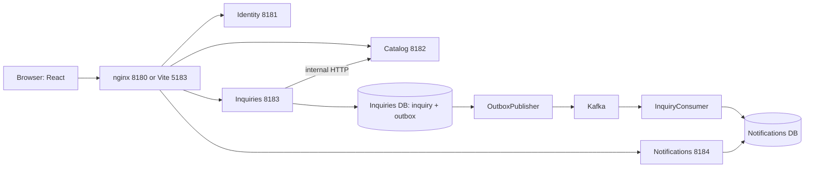

# 3. Trace the browser, events, and AWS journey

[Guide index](README.md) · [Previous: services](02-four-services.md) · [Next: debugging and practice](04-debugging-and-practice.md)

## The map in words

The browser renders React. Its API helper uses relative URLs such as `/api/inquiries`, so the request goes back to the origin that served the page.

In container mode nginx chooses the right backend from the path; in hot-reload mode Vite performs that routing. The backend does not run inside React, and the browser does not connect directly to PostgreSQL or Kafka.



Text equivalent: browser → same-origin proxy → chosen service → that service's database. Separately, Inquiries → private Catalog HTTP lookup, then persisted outbox → Kafka → Notifications consumer → recipient inbox row.

A browser subsequently reads that row through the Notifications HTTP API. Kafka does not push directly into this browser UI.

## Open these files beside the browser

| Layer | File and symbol | Responsibility |
|---|---|---|
| Entry | [main.tsx](../../frontend/src/main.tsx) | Mounts StrictMode, AuthProvider, and MarketplaceRoute |
| Shared identity | [AuthContext.tsx: AuthProvider](../../frontend/src/contexts/AuthContext.tsx), [useAuth](../../frontend/src/hooks/useAuth.ts) | Stores current auth state and restores a token through `/me` |
| Page composition | [MarketplaceRoute](../../frontend/src/routes/MarketplaceRoute.tsx) | Opens/closes discovery, login, editor, inquiry, workspace, and notification components |
| State/effects | [useMarketplace](../../frontend/src/hooks/useMarketplace.ts) | Filters, loading/error/empty states, requests, comparison, notifications, and refresh triggers |
| API operations | [marketplace.ts](../../frontend/src/services/marketplace.ts) | Defines typed identity/provider/inquiry/notification calls |
| Transport | [http.ts: api, ApiError](../../frontend/src/services/http.ts) | Fetch, headers, JSON, error handling |
| Inquiry attempt | [useInquiryAttempt](../../frontend/src/hooks/useInquiryAttempt.ts) | Preserves one key plus payload across an uncertain retry |
| UI form | [InquiryForm](../../frontend/src/components/inquiries/InquiryForm.tsx) | Collects fields, prevents normal form navigation, submits and renders progress/errors |
| Edge | [nginx.conf](../../frontend/nginx.conf), [vite.config.ts](../../frontend/vite.config.ts) | Routes public API paths to backend ports |

`MarketplaceRoute` is a component name, not evidence that React Router is installed. This application composes panels/dialogs without React Router. `api<T>` gives TypeScript callers a compile-time return shape; it does not perform runtime response schema validation.

Server input validation remains essential.

## Journey A: discover and sign in

1. `useMarketplace` stores search/filter/page state. Its discovery effect builds `URLSearchParams` and calls `providerService.list`. The API response provides real profile objects and total count; those are not read from browser persistence.
2. Each relevant effect creates an `AbortController`, passes its signal to the service, aborts in cleanup, and checks the signal before applying state. Changing filters or closing a component can abandon an obsolete request. This prevents an old response from replacing the newer view. StrictMode's development effect behavior makes correct cleanup especially visible.
3. `providerService.list` calls `api` with a relative path. nginx/Vite proxies it to Catalog. Catalog validates the query, executes SQL, and returns `{items,total}`. React renders a loading state before completion, an error on failure, and an empty state for a valid empty result. These are three different UI conditions.
4. Selecting “contact” while signed out opens login and remembers the selected profile in component state. [Login](../../frontend/src/components/auth/Login.tsx) calls `identityService.login`. The browser receives a signed token and actor details; `setAuth` stores the token under a project namespace and updates React state.
5. On a later page load `AuthProvider` reads that token and asks `/api/auth/me` for verified identity. It guards against a late restore response replacing a newer token. A failed restoration removes the matching stale token. A generic API 401 elsewhere becomes a friendly `ApiError` message; `api` does not itself globally clear the AuthContext or perform automatic refresh.

**Storage is deliberately limited, but includes an important exception:** localStorage holds the auth token and comparison IDs. `useInquiryAttempt` also stores a **temporary pending key and inquiry payload** in sessionStorage before sending. That payload is recovery intent, not proof of a committed inquiry or the source of the dashboard.

Once success is known, the attempt is removed. Treat that temporary content as sensitive browser data when discussing XSS.

Profiles, committed inquiries, and notifications still come from APIs.

## Journey B: click Send inquiry

Assume a synthetic client signs in as `company@demo.local` and contacts Ava's profile.

1. `InquiryForm` owns controlled inputs. A submit calls `preventDefault()` and converts the budget text with `Number`. Browser constraints improve feedback but do not replace backend Zod validation.
2. `useInquiryAttempt.submit` refuses a second simultaneous call using an `inFlight` ref. It creates a UUID key only for a new logical attempt. Before HTTP, it puts `{key,payload}` in sessionStorage under a key scoped by account and provider. For an existing uncertain attempt it reuses both values and freezes editing.
3. `inquiryService.create` sets `POST`, JSON body, and `Idempotency-Key`. `api` adds the bearer token and content type. nginx `/api/inquiries` goes to Inquiries at 8183 without changing the business payload.
4. `AuthGuard` verifies the token. `InquiriesService.create` requires CLIENT, validates body/key, locks client/key, checks a previous result, calls Catalog with an internal secret if new, and inserts inquiry plus outbox in one PostgreSQL transaction. See the [full service walkthrough](02-four-services.md).
5. After commit, the service returns 201 and the inquiry view. `api` checks `res.ok`, parses JSON, and resolves. A non-2xx response becomes `ApiError`; `fetch` by itself would not throw just because the server returned 403 or 500.
6. Only successful API completion calls `finish`: it removes the saved attempt and invokes `onSent`. `MarketplaceRoute` closes the form, shows the success text, and increments its reload counter. A network failure cannot honestly be described as a successful send, because the browser does not know whether the transaction committed.
7. A first-transmission explicit rejection from the set listed in the hook (400/401/403/404/413/422/429) clears that new attempt so the user can correct it. A failure while retrying an earlier uncertain attempt does not establish that earlier request's fate; the hook preserves that attempt. A 409 also preserves the attempt. Read this branch carefully before generalizing “every error means no database write”.
8. “Resolve saved inquiry” resends that exact key and payload. It does not guess by searching historical messages that happen to have the same text. Two legitimate inquiries can have identical content and different logical keys.

The frontend uses a ref to avoid accidental overlapping submissions, and PostgreSQL enforces durable idempotency across clients/processes. The UI guard is convenience; the database rule is the authority.

## Journey C: what happens after the HTTP response

[OutboxPublisher](../../backend/src/common/messaging.ts) runs inside the Inquiries process, but outside a specific HTTP request. After connecting a KafkaJS producer it repeatedly calls `publishBatch` and waits about 500 ms between successful iterations.

1. `publishBatch` opens a PostgreSQL transaction and selects up to 25 unpublished rows, oldest first, with `FOR UPDATE SKIP LOCKED`. A second publisher can skip rows another transaction already holds. The selected row stays pending unless the transaction commits its update.
2. It publishes the JSON event to the configured topic with `key=inquiry_id` and `acks=-1`, then updates `published_at`. The message key supports same-key partition routing; it is not the consumer's deduplication constraint.
3. If the broker call fails, the SQL transaction rolls back. The outbox remains pending, the worker health flag becomes false, and the outer loop disconnects/retries with a two-second pause. Event intent survives because it was saved before the HTTP response.
4. If Kafka accepts a message and the process crashes before the SQL update/commit, the outbox can publish it again after recovery. A batch can replay earlier sends if a later send fails and rolls the transaction back. `acks=-1` does not close this gap.
5. KafkaJS's consumer receives the event. It awaits the notification INSERT with its unique event ID before successful message handling. A SQL write followed by a crash before the offset commit can also replay. Deduplication again uses the event ID.
6. The provider opens notifications. `useMarketplace` loads the inbox on auth/reload/open/retry triggers. There is no WebSocket or server-sent event subscription and no periodic poll timer for notifications. If the event arrives after the current fetch, opening/retrying the inbox again can show it.
7. Clicking a notification calls `notificationService.read`. Only after success does the UI mark it read, close the dialog, and open the workspace. A failed read displays an error rather than pretending success.

```text
Time ->
Inquiry DB commit -> HTTP 201 -> broker publish -> notification SQL commit -> later browser GET
                     ^ reply may be lost
                                    ^ send may be repeated
                                                                ^ offset commit may lag
```

This is **at-least-once delivery with idempotent database effects** under the expected recovery assumptions. It is not an exactly-once transaction across PostgreSQL, Kafka, and the browser.

Local Kafka has replication factor one, so `acks=-1` still acknowledges only the available single-replica setup. Disk loss, retention expiry, lost outbox data, operator mistakes, and poison events are separate failure classes.

No implemented dead-letter queue or cross-region replication makes them disappear.

## Journey D: a provider accepts the inquiry

[Dashboard](../../frontend/src/components/inquiries/Dashboard.tsx) loads only participant inquiries via the API and renders ACCEPTED/DECLINED buttons for a provider's pending items. The click disables actions while busy, calls `inquiryService.respond`, and replaces the row with the returned view only after success.

Backend ownership and row-lock checks still enforce the rule if somebody bypasses the UI. The server accepts only `PENDING`, `ACCEPTED`, and `DECLINED`; the UI also tolerates a legacy `NEW` label, which does not create an additional backend status.

Responding does not currently emit a Kafka event.

## The prepared AWS environment uses the same application

Read [Terraform main](../../infra/aws-dev/main.tf), [AWS Compose](../../infra/aws-dev/compose.yaml), [host bootstrap](../../infra/aws-dev/user-data.sh), [deploy script](../../scripts/aws-deploy.sh), [remote deploy](../../scripts/aws-remote-deploy.sh), and [smoke script](../../scripts/aws-smoke.sh). These files describe a prepared **development** environment; consult execution evidence before saying it is deployed.

| Resource | Beginner meaning | What this repository prepares |
|---|---|---|
| VPC/subnet/routes/internet gateway | Host networking and outbound path | One development network/subnet with outbound internet routing |
| EC2 | A virtual Linux machine | One instance running Docker Compose; not ECS/EKS |
| Security group | Instance network rules | No ingress rules; outbound allowed. Browser access is through an SSM tunnel |
| Systems Manager / instance role | Managed commands and port forwarding without opening SSH | SSM policy attached to the host role, plus scoped runtime access |
| ECR | Private image registry | Backend/frontend repositories with immutable tags; releases select digests |
| Secrets Manager | Encrypted runtime secret storage service | Secret resource; runtime values must be populated separately and kept out of Terraform/source |
| S3 release bucket | Versioned private object storage | Release bundles under `releases/<source SHA>.tgz`, encryption, public access blocks and TLS policy |
| Terraform state bucket | Stores infrastructure's resource mapping | Separate bootstrap configuration; versioning and protection; not application database storage |
| IAM/OIDC | Temporary authorization | GitHub deployment role trust restricted to the named repository's `dev` environment |

The EC2 instance has metadata tokens required and an encrypted root volume. PostgreSQL and Kafka remain containers on that instance.

Separate DB users/databases do not mean managed RDS instances. Kafka does not become MSK just because it runs in AWS.

This is a single-host failure domain, and the root disk is configured to be deleted on termination. Docker volumes are persistence across container replacement, not an independent backup strategy.

Text deployment sequence: GitHub verification → build/publish backend and frontend images → identify ECR digests → bundle Compose/scripts/manifest in S3 → SSM downloads bundle on EC2 → host retrieves its own secret → Compose pulls exact images → checks readiness and smoke/API behavior → update current-release pointer.

Browser → SSM forwarding → host loopback port 80 → nginx container 8180 → chosen Nest container. No public load balancer or public HTTPS API endpoint is configured here.

The [deployment workflow](../../.github/workflows/deploy-dev.yml) performs checks and scans before deploying, but a file existing does not prove a successful workflow run. `aws-remote-deploy.sh` uses a host lock, writes a restrictive runtime environment file, pulls digest-referenced images, verifies readiness and acceptance, and restores the prior application Compose release on failure when one exists.

It does not reverse a schema migration or restore lost data. Production migrations need forward/backward compatibility and an explicit data-recovery plan.

**Extension study, not implemented infrastructure:** compare managed RDS with container PostgreSQL, managed messaging with this broker, ECS tasks with EC2 Compose, an ALB with TLS/WAF against SSM-only access, Multi-AZ resilience, backups/restore drills, structured centralized logs/metrics/traces, and an external identity provider. State the cost, operating burden, failure mode, and product need before proposing each service.

No command in this guide provisions AWS. The repository requires approval of the concrete saved Terraform plan and current cost estimate before provisioning; [AWS guide](../aws-dev.md) and [short-run guide](../short-run.md) contain that separate operational procedure.

**Checkpoint:** explain one complete request in two minutes, then spend another two minutes on what happens if the HTTP reply is lost, Kafka is down, or the consumer crashes immediately after inserting the notification.
